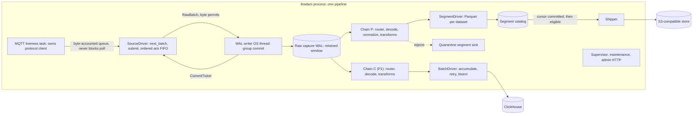
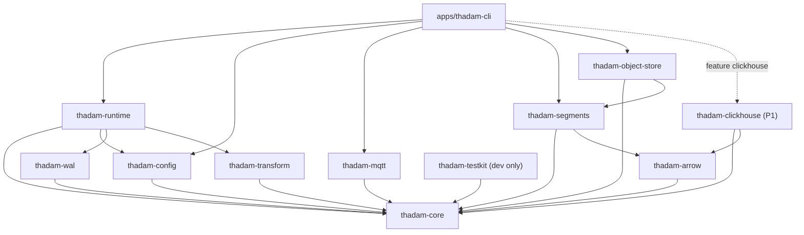

# Thadam Architecture

Status: CONDITIONALLY READY (verdict and exact blockers: `docs/design/readiness.md`; decisions: `docs/design/owner-decisions.md`). The owner accepted ADR-0001, 0002, 0003, 0006, 0011, 0012, 0013, 0018, and 0020 on 2026-10-07. Implementation is under way: PR1 to PR9, PR12, and PR13 are committed (the status table in section 21 has the hashes); wave 3, the runtime, is not started (paused, with no runtime code committed). The WAL was built before ADR-0004 was accepted, by the owner's choice, so its on-disk format is versioned but not frozen; the S1 re-run on x86 NVMe and ARM eMMC must still finish before ADR-0004 can be accepted and the format frozen. The owner still needs to apply `docs/design/product-amendments.md` Part A to `product.md`.

Owner decisions B2 (scope), B3 (product defaults), B6 (D5, D6, D8, D9, D10), and B7 (ADR-0012 YAML crate, ADR-0018 filter language), the ADR acceptances, and the EMQX 5.8.x pin were all made on 2026-10-07 and are reflected below. The three spikes have reported: S1 (WAL, `docs/design/spikes/S1-wal.md`), S2 (MQTT, `docs/design/spikes/S2-mqtt.md`), and the D8 record-representation microbenchmark (`docs/design/spikes/D8-record-representation.md`), and the ADR-0012 and ADR-0018 spikes (`docs/design/spikes/ADR-012-yaml.md`, `ADR-018-filter.md`). Their corrections are folded into sections 3 to 6, 10, 11, 14, 19, 21, and 22. The workspace MSRV is Rust 1.89 (raised from 1.88 for `serde-saphyr`). ADR-0004 stays Draft because the S1 re-run on x86 NVMe and ARM eMMC is still required before the on-disk format is frozen; ADR-0007 and ADR-0008 stay Draft by design (M2 and P1).

Last consolidated: 2026-10-07 (updated with the spike results and B6 the same day). Scope of this document: the current-state architecture of the Thadam MVP. It replaces six design documents that were written in sequence and partly contradict each other (listed in section 19). Where this document and `product.md` disagree, `product.md` remains the product source of truth until the owner applies the amendments in `docs/design/product-amendments.md`; the disagreements are cataloged there. The owner approved the scope amendments (Part A) on 2026-10-07 but has not yet applied them to `product.md`.

Tags used throughout: **[A]** assumption, **[V]** validate before relying on it, **[OPEN]** an owner or ADR decision is pending. Every ADR referenced here lives in `docs/design/adr/`; their statuses are in section 17.

## Contents

1. What Thadam is, and the MVP boundary
2. Architecture in one picture
3. Design decisions that shape everything else
4. Canonical model
5. Connector contracts
6. The capture WAL
7. Chains and transforms
8. Segments, Parquet layout, and shipping
9. Crate map and dependency rules
10. Concurrency, ownership, and bounded queues
11. Shutdown and crash recovery
12. Delivery guarantees
13. Error model
14. Observability
15. Configuration
16. Security and toolchain baseline
17. ADR index and status
18. Product section 37 validation items: where each is resolved
19. Superseded decisions
20. Reconciliations between the current plans
21. Implementation sequence
22. Open items

---

## 1. What Thadam is, and the MVP boundary

Thadam is a single-process, single-binary Rust edge runtime. It captures messages from robotic and IoT sources, stores them durably on local disk before acknowledging the source, then processes them into analytical datasets and delivers those datasets to sinks.

### Milestones

These milestones were decided by the owner on 2026-10-07 (B2, `docs/design/owner-decisions.md`).

- **M1 (MVP v0.1):** MQTT source, capture WAL, local Parquet segments, S3-compatible shipping, replay, and chaos verification. The M1 gate is the demo acceptance list in `examples/edge-capture` (section 21, PR18).
- **M2:** ROS 2. MCAP and rosbag2 offline ingestion first, then a live transport chosen by a spike. The owner decided that ROS 2 is not in v0.1.
- **M3 (P1):** ClickHouse sink, started only after the M1 reliability gate.
- **After the MVP:** HTTP and gRPC sources, aggregation and windowing, OPC UA, CAN, Iceberg and Delta, Python SDK, plugin mechanism, fleet management.

If capacity tightens, cut in this order: ClickHouse, then live ROS 2. M1 is never cut.

### Platforms

- Linux x86_64 and aarch64 are the only durability targets. macOS builds are for development only; durability claims do not cover macOS.
- The supported storage baseline is industrial SSD or eMMC that honors flush. SD cards are not a supported target for durability claims (owner decision B3, 2026-10-07). Honoring flush on the actual device remains an assumption **[A]** until the hardware evidence in ADR-0011 exists.
- Target envelope: 1 to 4 cores, 256 MB to 2 GB of RAM.

### Explicit non-goals for the MVP

GUI, cloud control plane, fleet management, remote configuration, Kubernetes operator, HTTP/gRPC/OPC UA/CAN/Modbus/Kafka/NATS/MQTT-publishing connectors, Iceberg/Delta/Snowflake/BigQuery, windowing and aggregation, joins, watermarks, WASM operators, ML inference, hot config reload, multiple pipelines per process, priority buffer queues, a dynamic plugin system, a schema registry product, application-level encryption at rest (document LUKS or filesystem encryption instead), command and control message transport, a video storage path, a Python SDK, and publishing crates before the naming ADR (ADR-0016, not yet written).

---

## 2. Architecture in one picture



The sequence for one message, in the common case:

1. The MQTT client delivers a message. The source stamps `ingest_time` and queues it.
2. The SourceDriver pulls a batch, submits it to the WAL writer, and queues the commit ticket in an ordered FIFO.
3. The WAL writer appends the batch as one frame, group-commits according to the fsync policy, and resolves the ticket.
4. The SourceDriver acknowledges the source in receive order. Only now does the broker consider the message delivered.
5. Each sink's chain reads the committed WAL, decodes, applies the dataset and transform steps, and hands events to its sink driver.
6. The segment sink writes rows to Parquet files per dataset. A finalized file advances the sink watermark. The runtime commits the cursor durably. Only then does the file become eligible for upload.
7. The shipper uploads eligible files with deterministic keys and create-if-absent semantics, then records the upload in the catalog.

---

## 3. Design decisions that shape everything else

Each decision has an ID (D1 to D24) from the architecture review. A decision is fixed once its ADR is Accepted. On 2026-10-07 the owner accepted ADR-0001, 0002, 0003, 0006, 0011, 0012, 0013, 0018, and 0020, so the decisions they own are fixed. D2 and D3 (WAL engine, fsync default) and the on-disk format details of D1 belong to ADR-0004, which stays Draft until the S1 re-run on reference hardware; the "provisional" wording below applies to that ADR-0004 content only. The `on_full` rule (D4) was decided by the owner in B3.

- **D1 Capture-first raw WAL (ADR-0003, ADR-0004).** The WAL stores raw source messages with a minimal envelope. Nothing is decoded or transformed before the source is acknowledged. Consequences: the on-disk format is independent of the in-memory model; a misconfigured filter loses nothing and is corrected by replay; chain failures never block capture; replay is a cursor rewind. Cost: decode and transform run once per sink, and WAL bytes during a sink outage are raw rather than reduced. Reversibility is low once released, because the format is permanent. S1 supports D1 on the WAL side (about 2% framing overhead for 200 B records, commit-to-ack is one group commit, the 10 MB/s reference load is 2% to 10% of the log's measured capacity); it did not measure chain CPU with one to three sinks or WAL growth during a sink outage, which ADR-0003 still lists.
- **D2 Custom segmented log as the WAL engine (ADR-0004).** No maintained Rust crate provides a segmented FIFO log with multiple cursors. S1 confirmed the choice: the custom log matched SQLite on every correctness test, wrote about half the bytes, reclaimed disk by `unlink`, and bounded recovery by one segment. SQLite in WAL mode stays the documented fallback; redb is not used for the bulk queue.
- **D3 Default `fsync: interval(10ms)` (provisional) with acknowledgement after fsync (ADR-0004).** The earlier default of 50 ms capped per-source throughput at the inflight window divided by about 50 ms (S1 and S2). `always` and `never` are documented alternatives. The default is re-measured on reference eMMC before it is frozen.
- **D4 `on_full` has no default (ADR-0004, ADR-0011).** Operators must choose `block` or `drop_oldest`. `thadam init` writes `block` with an explanatory comment. Decided by the owner on 2026-10-07 (B3); configuration validation fails if `on_full` is missing.
- **D5 Pull source contract (ADR-0002). Signed by the owner 2026-10-07 (B6).** The runtime calls `next_batch`, which is cancel-safe. Connectors keep protocol liveness themselves, independent of backpressure, and their protocol task never awaits the runtime. S2 confirmed both clauses against Mosquitto and EMQX.
- **D6 Split sink contracts (ADR-0002). Signed by the owner 2026-10-07 (B6).** `BatchSink` for transactional batch targets, `SegmentSink` for accumulating file targets. The shipper is a service, not a sink.
- **D7 MQTT `ack_mode` default is `on_commit` (ADR-0006).** `on_receive` is opt-in and documented as at-most-once across a Thadam crash. The owner did not select a producer-batching assumption (B3, 2026-10-07): batching is not assumed, so the throughput ceiling is documented as a limit. S2 validated the ceiling model, `max messages per second per connection ~ window / (commit latency + RTT)`, to within 6%.
- **D8 Shape-shared positional records (representation B) behind an opaque `Record` (ADR-0001). Signed by the owner 2026-10-07 (B6).** Field names live once per shape. Arrow appears only at sink boundaries. The D8 microbenchmark supports B (medium-high confidence): against keyed records it was 368 versus 488 to 712 bytes per W1 event and 11 to 13 ns versus 44 to 126 ns for the transform pass, and it was indistinguishable from shape-by-index records (C) single-threaded. `Record` is opaque so a later move to C changes only the name-based accessors.
- **D9 Extended value types (ADR-0001). Signed by the owner 2026-10-07 (B6).** Narrow integers, `f32`, typed primitive arrays. The measured win is the typed arrays (W2 joint state: 400 versus 1120 bytes per event). A 24-byte `Value` layout is evaluated in PR3.
- **D10 One event per source message, plus an explicit `explode` step (ADR-0001). Signed by the owner 2026-10-07 (B6).**
- **D11 Datasets are the output unit (ADR-0013).** Device identity is a column, never a partition or file unit.
- **D12 Wide Parquet layout with declared schemas per dataset (ADR-0013).** Decided by the owner on 2026-10-07 (B3).
- **D13 Declared schemas for production, dev-mode inference with widening only and lock-after-first-file (ADR-0013).**
- **D14 Microsecond Parquet timestamps by default, nanoseconds opt-in per dataset (ADR-0013).**
- **D15 Simplified time model (ADR-0001).** Source time, ingest time, corrected time, time domain, clock-synced flag. No `ClockInfo` in the MVP; the slot is reserved.
- **D16 Partition by ingest date, with an `unsynced/` partition when the clock was not synced (ADR-0013).**
- **D17 Deduplication is best-effort in Thadam and authoritative downstream (ADR-0011).** Warm-start from the WAL tail. Deadband and on-change are separate transforms.
- **D18 Commit the cursor, then ship (ADR-0011, ADR-0013).** Fixes a duplicate-object bug in the original design.
- **D19 Filter language (ADR-0018). Decided by the owner 2026-10-07 (B7).** Structured YAML predicates (`field`, operator, value, with `all`, `any`, `not`) for the MVP. CEL is reserved for a future ADR, and the `expr:` key is reserved for it.
- **D20 Ten library crates plus the CLI in the MVP workspace, split by dependency weight; `thadam-clickhouse` joins at M3 (section 9).**
- **D21 Memory claim wording (ADR-0011).** Thadam-owned buffers are bounded by configuration; total RSS is measured and published per workload.
- **D22 `serde_json::Value` at the connector configuration boundary (ADR-0012).** The YAML crate is `serde-saphyr` with `strict_booleans: true`, and `serde_norway` is the documented fallback (owner decision 2026-10-07, B7).
- **D23 Single MQTT connection in the MVP (ADR-0006).** Shared subscriptions are a documented future option with an ordering caveat.
- **D24 Replay uses the WAL retention window (ADR-0003).** MCAP is an export and import format only, not a recording tap. ADR-0015 (Draft) records the export format.

---

## 4. Canonical model

The canonical model lives in memory only. It is never written to disk by the WAL (D1). Owner ADR: ADR-0001. Crate: `thadam-core`.

### Types (illustrative sketch; B6 is signed, the exact signatures are settled in PR3)

```rust
pub struct Event { /* private; accessors and builder enforce invariants */ }
pub struct EventBatch { pub events: Vec<Event>, pub origin: WalRange, pub clock_synced: bool }
pub struct RawMessage { pub ingest_time: Timestamp, pub attrs: Attributes, pub payload: Bytes }
pub struct RawBatch { pub source: SourceId, pub messages: Vec<RawMessage>, pub clock_synced: bool }

pub struct Timestamp(i64);                 // nanoseconds since the Unix epoch, UTC
pub enum TimeDomain { Utc, Tai, Monotonic, Sim, Unknown }
pub struct Times { /* source (set once), ingest, corrected, domain */ }

pub struct Quality { pub status: QualityStatus /* Good | Uncertain | Bad */, pub flags: QualityFlags /* u32 bitset */, pub reason: Option<Sym> }

pub struct Shape { /* field names, types, units; fingerprint */ }
pub struct Record { /* private: shape: Arc<Shape>, values: Vec<Value> */ }  // opaque, see "Record API" below
pub enum Value { Null, Bool, I8, I16, I32, I64, U8, U16, U32, U64, F32, F64,
                 Str(Utf8Bytes), Bytes(Bytes), Ts(Timestamp),
                 F32s(Arc<[f32]>), F64s(Arc<[f64]>), I32s(Arc<[i32]>), I64s(Arc<[i64]>),
                 List(Vec<Value>), Record(Record) }
pub enum Payload { Record(Record), Raw { content_type: Sym, bytes: Bytes }, ObjectRef(ObjectRef) }
pub struct AssetPath(/* ordered (level, value) pairs; device is a level */);
```

### Record API (D8, D9)

The owner decided on 2026-10-07 (B6) on representation B (a shared `Arc<Shape>` plus a positional `Vec<Value>`) behind an opaque `Record`, so a later move to representation C (a per-chain `ShapeId(u32)` registry) changes only the name-based accessors. Neither field is public, and steps never compare `Arc` pointers themselves. The illustrative surface, from the D8 report:

```rust
impl Record {
    pub fn len(&self) -> usize;
    pub fn shape_key(&self) -> ShapeKey;                        // Copy + Eq + Hash. B: pointer identity. C: u32 id.
    pub fn get_at(&self, i: FieldIdx) -> &Value;                // hot path, identical under B and C
    pub fn set_at(&mut self, i: FieldIdx, v: Value);
    pub fn get(&self, name: &str) -> Option<&Value>;            // slow path; would need a registry under C
    pub fn iter(&self) -> impl Iterator<Item = (&str, &Value)>; // same caveat
}
```

Steps cache `ShapeKey -> ResolvedPlan` and use `get_at` on the hot path. Three guard rails keep B equivalent to C in the measurements: events are moved, not cloned, across threads on the hot path; shape registries are per chain, never process-global; and a chain is `!Sync`. `Record::clone` is a refcount bump plus a `Vec` clone and is not meant for cross-thread fan-out. Typed arrays (`Arc<[T]>`) convert in place only when uniquely owned; a shared array is copied on write.

`Value` is 40 bytes today because `Utf8Bytes(Bytes)` makes `Bytes` (32 bytes) its widest payload. The D8 report found that a 24-byte layout (a thin `Str` pointer, `List` as `Box<[Value]>`) would save about 112 bytes per W1 event, at the cost of the zero-copy WAL slice. PR3 evaluates that layout and records the result in ADR-0001; `Record` being opaque makes it an internal choice. D8 is to be re-measured on reference ARM and x86 hardware and with the real decoder (PR8) before any published claim.

### Semantics

- **Granularity (D10).** One event per source message by default (owner decision B6, 2026-10-07). The `explode` step turns a message containing an array of samples into one event per sample, with a `sample_idx`. Quality is event-level only for the MVP (owner decision B3, 2026-10-07); field-level quality is deferred.
- **Time (D15).**
  - `source_time` is what the device reported. It is set once at decode and never overwritten.
  - `ingest_time` is the edge receipt time, stamped by the source. It is never null and never changed.
  - `corrected_time` is optional. A correction must set a quality flag so device time is never silently replaced.
  - `time_domain` is configured per dataset or set by the decoder. Non-UTC source times (monotonic since boot, ROS simulation time, TAI from PTP) never become `event_time` without an explicit mapping.
  - `clock_synced` is recorded per batch from the kernel's NTP state **[V adjtimex status]**. Wall time is never used to measure durations; retention and rotation use monotonic time and WAL positions.
  - Sinks materialize `event_time = corrected.or(source if domain is Utc).or(null)`.
  - Timestamp parsing requires explicit units and rejects strings without a timezone unless one is configured.
- **Identity.** An ordered hierarchy of (level, value) pairs. `device_id` is just a level. Values are extracted from topic templates such as `{topic.3}` or from payload fields. No level is mandatory.
- **Quality.** A three-level status plus a flag bitset plus an optional reason, stored as columns. Flags in use across the plans: `OUT_OF_RANGE`, `CLOCK_SKEW`, `MISSING_TIME`, `OUT_OF_ORDER`, `DUPLICATE`, `STALE`, `SEQUENCE_GAP`, `DECODE_ERROR`. The set is documented in `docs/concepts/quality.md` when that document exists.
- **Event ID.** By default, `xxh3_128(epoch, frame_seq, record_index)`: deterministic per WAL record, stable across replay, but different for a broker redelivery. A dataset may configure `event_id.key` (for example `[site, robot, seq]`) to derive the ID from content. Deduplication across broker redelivery requires a content-derived ID. If a dataset enables `dedup` without `event_id.key`, validation fails. The deterministic default hash is only meaningful when the payload carries a source sequence or a high-resolution source timestamp.
- **Payload kinds.** Sources emit raw bytes. Decoding produces a `Record` that conforms to a declared dataset shape. Large media travel as an `ObjectRef`. There are no `Pose` or `Ros2Msg` variants in the core model; robotics types are `Record`s that follow well-known field conventions (for example `frame_id` is a payload field, not an envelope field).
- **Envelope columns every dataset carries.** `_event_id`, `_ingest_time`, `_source_time`, `_event_time`, `_time_domain`, `_quality_status`, `_quality_flags`, `_quality_reason`, `_clock_synced`, `_wal_epoch`, `_wal_pos`, identity level columns, and `sample_idx` for exploded datasets. A source sequence number such as the demo's `seq` is a declared payload field, not an envelope column. Lineage lets any row be traced to its capture record without logging payloads.
- **Interning and limits.** Interning tables and shape caches are size-capped, because keys can come from untrusted payloads. Overflow becomes a counted reject, not unbounded growth.

### What stays out of the model

`schema_id` per event, `frame_id` in the envelope, `ClockInfo`, protocol-specific types, and a separate `device_id` field. These were in the original design and were removed (section 19).

---

## 5. Connector contracts

Owner ADR: ADR-0002 (D5 and D6 signed by the owner 2026-10-07). Crate: `thadam-core`. Contracts are 0.x and unstable until after the first release. There is no `contract_version` and no broad capability negotiation; the plugin question is deferred to ADR-0017 (not yet written).

### Source (pull)

```rust
#[async_trait] pub trait Source: Send + 'static {
    async fn open(&mut self, ctx: &SourceContext) -> Result<(), ThadamError>;
    async fn next_batch(&mut self, limits: BatchLimits) -> Result<Option<SourceBatch>, ThadamError>; // MUST be cancel-safe
    async fn close(&mut self) -> Result<(), ThadamError>;
}
pub struct SourceBatch { pub batch: RawBatch, pub ack: AckHandle }
```

Clauses every source implementation must satisfy, each tested by the conformance suite in `thadam-testkit`:

- **Liveness.** The connector keeps protocol liveness (MQTT PINGREQ, DDS heartbeats, session maintenance) regardless of how slowly the runtime pulls. The suite stalls the consumer for three times the keepalive interval and requires that the connection stays up and no QoS 1 message is lost.
- **Cancel-safety of `next_batch`.** Dropping the future never loses a message; messages stay in the connector's queue. The suite drops the future at random points. All other cancellation is cooperative, through a `Shutdown` token.
- **Ordered acknowledgement.** The runtime completes `AckHandle`s strictly in receive order after the corresponding WAL commit. Because capture is first (D1), every raw batch is committed and acknowledged before any chain filters it, so filtering never affects acknowledgement; an empty batch is still acknowledged, after earlier batches commit. This satisfies the MQTT rule that PUBACKs are sent in receive order.
- **The protocol task never awaits the runtime.** The connector's protocol task (for MQTT, the owner of the client event loop) waits only on the protocol library: never on a bounded queue the runtime drains, never raced against a timer or token inside a library call. S2 showed that blocking it causes a broker disconnect and then a deadlock. Memory is bounded by byte accounting and the protocol's own flow control, and a guard disconnects instead of blocking.
- **Epoch-scoped acknowledgement handles.** An `AckHandle` is valid only for the connection or session in which its message arrived. A handle from an older epoch is a counted no-op. S2 (E1) showed that stale acks after session loss acknowledge the wrong new messages, which is silent loss. The connector also restores its subscriptions after a session loss.
- **Handles hold no payload.** An `AckHandle` carries only the protocol's acknowledgement identity (for MQTT, packet identifier and QoS), so a pending ack never pins payload memory (confirmed in S2: 1.9 MiB stripped versus 79.7 MiB retained for 1000 unacknowledged 64 KiB messages).
- **Lost-token detection.** `thadam_ack_oldest_age_seconds` and a watchdog expose handles that were never completed.
- **Panic isolation.** A connector panic is caught at the task boundary and marks the component `Failed`.
- **Ack-mode capability.** `AckMode` is `None`, `OnCommit`, or `OnReceive`. This is the only source capability in the MVP.

### BatchSink and SegmentSink

```rust
#[async_trait] pub trait BatchSink: Send + 'static {
    async fn open(&mut self, ctx: &SinkContext) -> Result<SinkCapabilities, ThadamError>; // probes; reports effective delivery class
    async fn write(&mut self, batch: &SinkBatch) -> Result<WriteOutcome, ThadamError>;    // same BatchId on every retry
    async fn close(&mut self) -> Result<(), ThadamError>;
}
#[async_trait] pub trait SegmentSink: Send + 'static {
    async fn recover(&mut self, ctx: &SinkContext) -> Result<Option<WalPos>, ThadamError>; // durable-through position
    async fn append(&mut self, batch: SegmentBatch) -> Result<Vec<Reject>, ThadamError>;    // events grouped by dataset; takes ownership; may buffer
    async fn poll_commit(&mut self) -> Result<Option<WalPos>, ThadamError>;                 // finalize due files; new watermark
    async fn finalize_all(&mut self) -> Result<Option<WalPos>, ThadamError>;
    fn cursor_committed(&mut self, pos: WalPos);                                           // enables ship eligibility
}
```

- **BatchSink** (ClickHouse, a single object PUT): the runtime forms deterministic batches on frame boundaries, retries the same `BatchId`, and advances the cursor on success. The only sink capability is the delivery class: `AtLeastOnce` or `IdempotentBatch`.
- **SegmentSink** (Parquet, NDJSON for debugging): the sink owns open state and reports a watermark. The runtime advances a cursor only to a committed watermark, at frame granularity.
- **Implementation note (2026-10-08, commit `f2c2282`):** `append` originally took an `EventBatch` (the sketch the ADR-0002 decision was signed against). It now takes a `SegmentBatch` (`thadam-core`): the segment driver passes each chain read as one `append`, covering a single WAL range with the events grouped by dataset in declaration order (empty datasets included). Rejects index the events in that flattened order (datasets in declaration order, WAL order within each; `SegmentBatch::events` iterates the same way), and quarantine rows arrive under `QUARANTINE_DATASET` (`"_quarantine"`). `BatchSink` is unchanged: `BatchSink::write` takes a `SinkBatch` with no dataset id, so the batch driver concatenates the datasets' events; the same grouping for `thadam-clickhouse` (one table per dataset) is open work needed before PR20.
- **The shipper is not a sink.** It is a service that consumes finalized segments through the catalog (section 8).
- **Errors.** Every error carries `Transient`, `Permanent`, or `Fatal` retry class. Transient errors retry with the same `BatchId`. Permanent per-event errors become rejects routed to quarantine. Fatal errors mark the component `Failed`.
- **Configuration boundary.** Factories receive `serde_json::Value` (D22), with typed structs inside each connector. No YAML types cross the boundary.
- **Not yet specified [A].** The `SinkBatch` type (it carries `BatchId` plus the `EventBatch`) is to be defined in PR3 and PR4.

---

## 6. The capture WAL

Owner ADRs: ADR-0003 (placement) and ADR-0004 (engine and format, Draft). Crate: `thadam-wal`. Spike S1 has reported, and the layout below is its recommendation adopted as built. **The format is frozen only when ADR-0004 is accepted, and ADR-0004 stays Draft until the S1 re-run on x86 NVMe and ARM eMMC is done**, because the format becomes permanent once released and S1 ran without reference hardware. The owner decided to build the WAL now and re-validate on reference hardware later, so `thadam-wal` is implemented (PR6 and PR7, `0c4cf6f`) with a versioned but not frozen format v1.

### Contents and format (S1 recommendation; not frozen)

All integers are little-endian.

- **Segment header (64 bytes):** magic `THADMWAL` at `[0, 8)`, `format_version u16` at `[8, 10)`, a reserved `u16`, `epoch u64` at `[12, 20)`, `base_seq u64` at `[20, 28)`, `created_unix u64` at `[28, 36)`, zeros to byte 60, and a CRC32C of bytes `[0, 60)` at `[60, 64)`. Segments are 64 MiB by default and 16 MiB on the edge profile. A segment is created as a temporary file, header written, fsynced, renamed, and the directory fsynced, so a half-written segment never has a valid name; it is truncated to its data when sealed. A bad segment header fails the open (the only exception is an empty last segment).
- **Frame:** a 24-byte header, `magic u16 | version u8 | flags u8 | len u32 | frame_seq u64 | reserved u32 (must be 0) | crc32c u32`, followed by a prost-encoded `RawFrame { source_idx, clock_synced, dict: repeated string, records: repeated RawRecord { ingest_time_ns, attr_refs, payload: bytes } }`. **This resolves open item O9:** the earlier "24 bytes but the fields total 20" inconsistency came from omitting the reserved word. The CRC32C covers header bytes `[0, 20)` followed by the payload. There is no separate header CRC and no resynchronization inside a sealed segment: a corrupt frame is quarantined from that frame on and surfaced as `Gap::Corrupt`. The end-of-data marker is an all-zero 24-byte header (the magic is non-zero). S1 did not exercise the prost payload; its encode and decode cost and its field numbers are validated before the format is frozen.
- **One frame per source batch**, capped at `frame_max_bytes` (4 MiB). A message larger than `max_message_bytes` (default 8 MiB) is rejected at the source with a counted drop where the protocol allows it. For MQTT it is not possible (the client library fails the connection), so the packet-size limit is aligned with `max_message_bytes` instead (section 10, ADR-0006).
- The WAL stores raw messages only. It never decodes events and never depends on the canonical model.

### Behavior

- **Writer.** One OS thread exclusively owns writable files. Submissions arrive through a bounded channel plus a byte semaphore. The writer drains pending submissions up to `group_max_bytes` (4 MiB) or until the fsync interval elapses, then performs one `write` and one `fdatasync` per group. Tickets resolve in submission order.
- **fsync policy.** `always`, `interval(ms)` (provisional default **10 ms**, D3; S1 found that 50 ms caps per-source throughput at the inflight window divided by about 50 ms), or `never`. `never` survives a process crash only. The per-source acknowledgement ceiling is `inflight window / (interval + fsync latency)`. The default is re-measured on reference eMMC before it is frozen. Unbatched small messages amplify writes under `always` (about 12.8 times the payload for 200 B messages at 5,000 per second on Linux), which producer batching or a longer interval reduces.
- **fsync failure rule ("fsyncgate").** After a failed fsync, Linux may drop dirty pages and clear the error. A failure is therefore fatal for that segment: seal it, stop acknowledging, restart the writer, and re-verify. The fsync is never retried. No ticket may resolve successfully after a failed fsync. **Re-verification must not trust the page cache:** S1 showed that a reopen after a failed fsync reads a never-acknowledged frame back from cache. Either re-read with `O_DIRECT` or after `posix_fadvise(DONTNEED)`, or (the recommended default) treat everything after the last successful fsync offset as unacknowledged, seal the segment there, and let the sources redeliver.
- **Readers.** Each reader opens its own read-only descriptors and never reads past the **durable end** (the last successful fsync, not the written end), published through a `watch` channel. Unlinking a segment does not invalidate an open descriptor on Linux. `mmap` is rejected (SIGBUS risk). Sequence numbers at or below a durable cursor are never reused: on open, a cursor at or beyond `next_seq` (possible after a power loss under `interval` or `never`) makes recovery skip ahead to cursor + 1 and report the skipped range (`RecoveryReport::skipped`); the implementation always skips and never refuses the open for this (ADR-0004, "Implementation notes"). A reader returns `ReadItem::Frames` (consecutive frames) or `ReadItem::Gap`.
- **Preallocation.** Not on macOS (S1: appends 1.3 to 2 times slower and twice the bytes written on APFS). On Linux `fallocate` is optional and decided on reference hardware. Preallocated segments rely on the all-zero end-of-data header.
- **Open and recovery never allocate space.** The next segment is created lazily on the first append, and deletion is ordered before any allocation, so consumers can drain and reclaim on a full disk. `max_disk` enforcement stays well below filesystem capacity so ENOSPC is a fallback, not the normal path. (S1's open always allocated a segment and could not reopen after ENOSPC.)
- **Cursors.** One file per consumer in `cursors/<name>.cur` holding (epoch, committed position, optional in-flight range, CRC). Written through temp file, `fdatasync`, rename, and directory fsync on every `commit_cursor` call; the WAL does not batch commits, so callers batch them (the 200 ms `cursor_commit_interval` guidance stands, because each commit costs two flushes). A cursor with a mismatched epoch is refused; a cursor beyond the WAL end is skipped past and reported, as above.
- **Retention.** Whole segments are deleted once every required sink's cursor has passed them, subject to `retain_for` (a reprocessing window bounded by the disk budget). Each sink sets `required` (default `true`) and, for a required sink, an optional `max_lag` (`{ bytes: <size> }` or `{ age: <duration> }`; section 15 has the exact keys). A `required: false` sink never holds retention back and sees a `Gap::Evicted` if it falls behind eviction. A required sink that exceeds `max_lag` is evicted from retention, which is an explicit, counted loss for that sink. All time-based decisions use monotonic durations and WAL offsets.
- **Disk budget and `on_full`.** `DiskBudget` has per-category atomics (WAL, segments, quarantine). `block` withholds acknowledgements, which moves loss risk to the broker. `drop_oldest` evicts the oldest segments, surfaces `Gap::Evicted` records to readers, and increments `thadam_wal_evicted_bytes_total`. Under either policy the loss is counted and visible. This is the single place inside Thadam where data can be lost.
- **Gaps.** `Gap::Corrupt`, `Gap::Evicted`, and `Gap::Missing` (positions never durably written, or skipped so no position at or below a durable cursor is reused) reach readers as items, never as silent skips.
- **Implementation notes (PR6 and PR7, `0c4cf6f`; ADR-0004).** The WAL root is `data_dir/wal`, holding `LOCK`, `wal.json` (kind, format versions, epoch, node and machine binding), `segments/`, and `cursors/`; the runtime owns `data_dir/thadam.json`. Retention never deletes the newest segment, because it carries the sequence high-water mark across restarts. After a failed write or fsync the writer truncates what was not acknowledged and stops, and the WAL must be reopened. A `failpoints` cargo feature exposes fault injection to other crates. Format v1 is versioned but not frozen.
- **Recovery.** Section 11.

### Not exposed

Frame and segment layout, the writer thread handle, file descriptors, `mmap`, random access by time (see open item O6), priority queues, and any event decoding.

### Evidence

Spike S1 (`docs/design/spikes/S1-wal.md`) compared the custom log, SQLite, and redb on macOS (real flushes) and a Linux VM. The custom log had zero failures in 2,200 kill -9 iterations, 300 LazyFS iterations, and 2,248 torn-tail cases; wrote about 1.0 times the payload (SQLite about 2 times, 3.1 times with reclaim); reclaimed by `unlink` (disk stays at the backlog plus one segment); recovered in 5 to 12 ms independent of backlog; and used 3 to 8 MiB of RSS. redb is not used for the bulk queue (720 ms recovery at 2.6 GiB, a file that never shrinks, about 1 GiB of RSS by default, data loss on a process crash with `Durability::None`); SQLite does not latch after a failed fsync.

**Still required before the format is frozen (ADR-0004):** the S1 re-run on x86 NVMe and ARM eMMC (flush latency, device-level write amplification, eMMC recovery against a 50 ms criterion, the fsync default, Linux preallocation, segment size); validation of the prost `RawFrame` payload; an ENOSPC test on a loop device with lazy allocation; a directory-metadata loss test (`dm-flakey` or a power-cut rig); and the hardware power-cut rig before any power-loss claim.

---

## 7. Chains and transforms

Owner ADRs: ADR-0003 (chains), ADR-0011 (deduplication responsibility), ADR-0018 (filter language). Crate: `thadam-transform`, driven by `thadam-runtime`.

Each sink has a chain: WAL reader, dataset router, decode, normalize, transform steps, then the sink driver. A chain is synchronous, pure, and `!Sync`, owned by one task. A slow chain cannot block capture.

### Rules

- **Chains always use the current configuration from their cursor.** Replaying old data after a config fix applies the new config. This rule is stated to users explicitly.
- **Panic isolation per chain.** A poison message is retried `poison_retries` times, then quarantined, and the cursor advances.
- **Limits.** `ChainLimits` (`max_shapes`, `max_dedup_keys`, maximum JSON depth) convert overflow into rejects.
- **Primary chain [A, O3].** One chain is designated primary for quarantine and reject metrics, to avoid double-counting when several chains see the same raw message.

### Processing order within a dataset

1. Decode at message level.
2. Event ID derivation and message-level deduplication. This keeps dedup memory small because it runs before `explode`.
3. `explode`, when configured.
4. Field extraction and unit conversion (`from:`, `convert_to:`).
5. Time extraction, domain handling, and skew flagging (`max_skew`).
6. The `transforms:` list, in listed order, filtered by the `dataset:` selector: `validate`, `on_change`, `filter`, sampling.

### MVP transform set

- Router and decode (JSON). JSON field names are resolved once per shape.
- Event IDs (section 4).
- Time extraction with units, domains, and `max_skew` flagging.
- Rename, project, and cast. Casts widen only (I32 to I64 to F64) and never narrow.
- Units: a runtime table keyed by UCUM codes, including prefixes (for example `dCel`, `mV`, `mA`), with element-wise conversion on typed arrays **[V prefix handling]**.
- `explode` with `index_field`, and the `^/` parent-path syntax so a field inside an exploded sample can read a field from the parent message.
- `validate`: per-field rules (`min`, `max`) that assign a quality flag and status.
- Deduplication: a bounded time and size window, warm-started by reading `[cursor - window, cursor)` from the WAL through `Step::warm` without emitting. Deduplication is best-effort. Authoritative deduplication happens downstream (ReplacingMergeTree, or `QUALIFY`/`DISTINCT ON` over Parquet).
- `on_change` (deadband) with a heartbeat. This is value-based and lossy by design. It is a different operation from deduplication; product.md section 5 (UC-05) conflates them.
- Sampling: every-N and minimum-interval, based on event or ingest order, never wall time.
- `filter`: language per ADR-0018.
- Enrichment from a static YAML or CSV file whose hash is recorded in lineage.

### API shape and decisions made in PR8 and PR9 (`424c2cc`)

From the `thadam-transform` crate documentation and source.

- **One batch per dataset.** `Chain::process` takes a `FrameInput` (WAL frames adapted to `RawRecordView`s by the runtime) and emits a `ChainOutput`, which holds one `EventBatch` per dataset (`DatasetBatch { dataset, batch }`). `batches[i]` belongs to the chain's `i`th dataset, in declaration order. The output is made by `Chain::new_output`, which sets the origin and clock state every batch carries, so a dataset with no events still reports the WAL range the chain consumed. Records no dataset matched are counted (`ChainStats::unmatched`) and are not rejects; per-event errors become `RejectedRaw` with the raw bytes kept.
- **`ChainSpec` is built by the runtime.** `ChainSpec` is defined in `thadam-transform`, and `thadam-runtime` builds it from the parsed pipeline with `ChainSpec::from_value`, passing the `datasets` and `transforms` of the config as a `serde_json::Value` (so `thadam-transform` does not depend on `thadam-config`). `with_base_dir` sets the directory relative enrichment paths resolve against (the config file's directory), and `Chain::compile(&spec, limits)` turns it into a `Chain`. `Chain::warm` rebuilds step state from earlier records without emitting.
- **Identity must be passed as an ordered list.** An identity is a hierarchy, so its order matters. `IdentitySpec` accepts either a mapping or a list of single-entry mappings, but a mapping is read in the order the deserializer yields its keys, which is alphabetical for `serde_json::Value`. The runtime therefore passes the levels as an ordered list (the order `thadam-config` keeps, section 15), never as a mapping built from a `Value`.
- **Time domain defaults to `unknown`.** A dataset's `time.domain` is `utc`, `tai`, `monotonic`, `sim`, or `unknown`, and absent means `unknown`, so a mapping to UTC is always explicit. Only `utc` becomes the event time.
- **Skew and missing time are flagged, never corrected.** When a UTC source time differs from the ingest time by more than `max_skew`, the event gets the `CLOCK_SKEW` quality flag; when the source time is absent, it gets `MISSING_TIME`. The source time is stored as read, and no corrected time is written (section 4: any correction must set a quality flag).

### Determinism

"Byte-identical Parquet on replay" is not a claim. The defined property is **row-set equivalence** for the same WAL range, the same configuration hash, and the same enrichment-file hash: identical `_event_id`, values, and flags. File boundaries may differ. Event IDs must therefore be deterministic and sampling must not depend on wall time. A test requires that replaying the same frames twice yields an equal row set and that warm-then-process equals a continuous run.

### Not exposed

A user-defined step trait (sealed until the plugin ADR), windowing and aggregation, Arrow types, async, and any I/O beyond loading the enrichment file at compile time.

---

## 8. Segments, Parquet layout, and shipping

Owner ADR: ADR-0013 (layout), ADR-0011 (commit-then-ship), with ADR-0009 (object-store architecture, not yet written) reserved for the shipper detail. Crates: `thadam-arrow`, `thadam-segments`, `thadam-object-store`.

### Datasets

A dataset is an output table: a `match` (source and topic), a decode format, an identity template, an optional `event_id.key`, optional `dedup`, optional `explode`, a `time` rule, and a declared field list. Device identity is a column. Partitioning per device or per stream is rejected because it does not scale: 500 robots would mean 500 open writers and a small-file explosion, and 1000 streams cannot fit in 256 MB at all. Open writers are capped by `max_open_files` (4 on the edge profile). The least recently written file is finalized early when the cap is reached.

### Schemas

- **Production:** declared schemas are required. Fields have a name, type, source path, optional unit, optional `convert_to`, and optional `required: true`.
- **Development:** inference is allowed with widening only and lock-after-first-file, to avoid file churn from JSON `1` versus `1.5`.
- **Unknown fields:** strict mode quarantines, lenient mode drops and counts, and an optional `_unmapped` column can capture them.
- **Evolution rules (Iceberg-compatible):** add optional columns, widen `int` to `long` and `float` to `double`, never rename or narrow. Anything else is a new dataset version (`dataset@v2`).
- **Unsigned integers** follow a per-sink unsigned policy (`ArrowOptions.unsigned`). The default is `Native` (`UInt8` to `UInt64`); `Signed` maps to the next wider signed type, with `u64` staying `Int64` and a value above `i64::MAX` rejected (`schema.narrowing`). Reader support for unsigned logical types is still **[V]**.
- **Field IDs.** Every column is written with a stable Parquet field ID (`PARQUET:field_id`) from the first release. This makes a later Iceberg `fast_append` stage cheap, with no rewrite. The assignment policy (O5, closed in PR13, ADR-0013): envelope and lineage IDs 1 to 99 are fixed by `thadam-arrow` (format v1); identity level IDs are explicit in 100 to 199; declared top-level field IDs are explicit, required, and in 1000 to 4,194,303; nested IDs (list elements and record children) are derived from the parent ID and tree position, starting at 8,388,608. IDs are never reused after a field is removed (the configuration owner enforces this; `thadam-arrow` rejects duplicates and out-of-range IDs). `_wal_record_idx` (O4) is not written and ID 13 is reserved for it. Other encoding choices: `sample_idx` is `UInt16`, list elements are named `element`, and `thadam.schema_fp` is a 16-byte SHA-256-based fingerprint over a canonical, versioned column encoding (ADR-0013, "PR13 implementation decisions"). The pipeline configuration has no key for field IDs or level IDs yet.

### Parquet file layout

- **Ready path:** `ready/<dataset>/date=YYYY-MM-DD/hour=HH/{node_id}_{epoch:016x}_{first:020}_{last:020}.parquet`. Date and hour come from `_ingest_time`. When `clock_synced` was false, the file lands under `ready/<dataset>/unsynced/` instead.
- **Footer metadata:** `thadam.version`, `thadam.dataset`, `thadam.schema_fp`, `thadam.wal_range`, `thadam.config_hash`, `thadam.enrichment_hash`, `thadam.clock_synced`, plus min and max `event_time` statistics. Joint names and similar dataset metadata also go in key-value metadata.
- **Timestamps:** `Timestamp(Microsecond, "UTC")` by default. Nanoseconds are opt-in per dataset. Reader compatibility across DuckDB, pyarrow, Spark, Trino, and Athena is tested **[V]**.
- **Writer settings:** row groups sized by bytes (8 MiB on the edge profile, flushed on `ArrowWriter::in_progress_size()`), dictionary encoding on low-cardinality strings, statistics on time columns, bloom filters off, `created_by = "thadam <version>"`.
- **Compression:** `snappy` by default on aarch64 and `zstd(1)` on x86_64, pending benchmark B6. Both are configurable.
- **Rotation:** whichever of `max_bytes`, `max_rows`, `max_age` comes first, or shutdown. Production default is `max_age: 5m`, `max_bytes: 128MiB`. The demo uses 60 s so output appears quickly.

### Finalize sequence (commit-then-ship, D18)

1. `ArrowWriter::close`, computing SHA-256 while closing.
2. `fdatasync` the file.
3. Rename from `staging/` to `ready/`.
4. fsync the directory.
5. Append a `Finalized` record to the catalog log (fsync).
6. Return the new watermark.
7. The runtime commits the cursor durably.
8. The sink is told through `cursor_committed`, and appends an `Eligible` record to the catalog.
9. Only then may the shipper upload the file.

The original design uploaded before the cursor was durable. A crash between upload, local deletion, and cursor commit regenerated the same range with different boundaries and uploaded a second object. Local deletion requires both an `Uploaded` record and cursor at or beyond the file's end.

### Segment catalog

An append-only, CRC-checked `catalog.log` with `Finalized`, `Eligible`, `Uploaded`, and `Deleted` records. The catalog is shared through `Arc` and a mutex held only across in-memory updates; its fsynced append runs on the blocking pool through a single-writer queue. At startup, files in `ready/` missing from the log are read for their footer `thadam.wal_range` and appended. The pending-upload queue lives in the catalog on disk, not in memory.

### Shipper (`thadam-object-store`)

- **Key:** `{prefix}/thadam/v1/{pipeline}/{dataset}/date=.../hour=.../{node_id}_{epoch:016x}_{first:020}_{last:020}.parquet`. Hive-style, so DuckDB, Trino, Athena, and Spark read it directly.
- **Epoch.** A random ID created when the data directory is initialized. It prevents key collisions if a data directory is wiped and WAL positions restart. Machine-id binding detects a data directory copied to another node.
- **Upload.** Oldest first with `upload_concurrency` (2). Files at or below `multipart_threshold` (32 MiB) use one `put_opts(PutMode::Create)`; larger files use multipart with `part_size` (8 MiB) chunks. Objects appear atomically.
- **Conflict.** On `AlreadyExists`, HEAD the object and compare size and `thadam-sha256`. Equal is success, the expected path after a crash between upload and catalog update. Different is the Fatal `OBJECT_KEY_COLLISION`.
- **Conditional writes.** `object_store` defaults to `S3ConditionalPut::ETagMatch`, documented for MinIO and R2. A startup probe detects stores that ignore it. If unsupported, the shipper falls back to overwrite, which is safe only because finalized files are immutable and keys are deterministic.
- **Retry.** Inner `object_store` retries plus an outer unbounded per-file backoff with jitter (1 s initial, 60 s cap). Edge uploads never give up, and stay visible through `thadam_ship_retry_age_seconds`.
- **Clock skew.** `RequestTimeTooSkewed` is Transient with a long backoff and a status warning, correlated with `thadam_clock_synced`. A device without an RTC fails every signed request until synced.
- **Credentials.** Wrapped in `Secret<T>`, redacted from logs and `Debug` output.
- **Orphaned multipart uploads** rely on a documented bucket lifecycle rule. Thadam never needs `ListMultipartUploads`.
- **Local retention modes:** `delete_after_upload`, `keep_for`, `keep_until_disk_pressure`. Pressure eviction order: uploaded and expired, then uploaded, then policy.
- **Replay output.** Replays write to a separate directory or an isolated prefix (`.../replays/{replay_id}/`), never the production prefix.

### Quarantine

A segment sink with a fixed schema: `_wal_epoch`, `_wal_pos`, `_ingest_time`, `source_id`, `topic`, `error_domain`, `error_code`, `reason`, `raw` (binary, truncated at 64 KiB with a `raw_truncated` flag). It has its own disk budget so a schema change cannot starve normal data. A reject is fsynced into the quarantine's staging file before its sink's cursor may pass it, so the segment's rotation never holds back the owning sink (ADR-0004, implementation notes for commit `6a56578`).

---

## 9. Crate map and dependency rules

Ten library crates plus the CLI form the MVP workspace (eleven members). `thadam-clickhouse` is an eleventh library crate that joins at M3. The split follows dependency weight and change rate (D20). All crates are `publish = false` until the naming ADR (ADR-0016, not yet written).

```text
crates/thadam-core          model, errors, positions, connector traits, clock, shutdown, disk budget
crates/thadam-config        YAML to typed PipelineSpec, interpolation, diagnostics, JSON Schema
crates/thadam-wal           capture WAL: writer thread, readers, cursors, retention, recovery
crates/thadam-transform     sync and pure: router, decoders, shapes, steps, chain compiler
crates/thadam-runtime       drivers, supervisor, shutdown, replay, observability, admin API
crates/thadam-arrow         Event to Arrow RecordBatch, dataset schema mapping, field IDs
crates/thadam-segments      Parquet and NDJSON segment sink, catalog, quarantine writer
crates/thadam-object-store  S3-compatible shipper over the segment catalog
crates/thadam-mqtt          MQTT source (rumqttc)
crates/thadam-testkit       memory connectors, conformance suites, fake clock, crash harness
crates/thadam-clickhouse    P1 BatchSink; excluded from the default build and workspace until M3
apps/thadam-cli             binary `thadam`; the only composition root
tools/thadam-simulator      synthetic fleet to MQTT, with a send-oracle manifest
tools/thadam-bench          scenario runner and result collection
tests/e2e                  docker and process-level end-to-end and crash tests
```

ROS 2 crates (`thadam-ros2-msg`, a source crate, and an MCAP source) are added when M2 starts.



### Rules, enforced by `cargo deny` bans and `scripts/check-deps.sh` (with a `--self-test` that must fail on a violating fixture)

- `thadam-core` has no Tokio runtime, Arrow, protocol crates, or YAML crate.
- `thadam-runtime` has no Arrow, Parquet, `object_store`, `rumqttc`, or `reqwest`. It knows connectors only through `thadam-core` traits.
- Connector crates never depend on `thadam-runtime`. Only `apps/thadam-cli` composes everything.
- Arrow appears only in `thadam-arrow`, `thadam-segments`, and `thadam-clickhouse`, and only as sub-crates (`arrow-array`, `arrow-schema`, `arrow-buffer`, `arrow-ipc`), never the umbrella `arrow` crate. Arrow types never appear in `thadam-core`, `thadam-transform`, or `thadam-runtime` APIs.
- `thadam-testkit` is never a production dependency.
- `thadam-clickhouse` and ROS 2 crates are excluded from the workspace until their milestones start.
- Workspace policy: `unsafe_code = "forbid"` (filesystem syscalls go through `rustix`'s safe API), `clippy::unwrap_used` and `clippy::expect_used` denied outside tests, `missing_docs` warn, `#[non_exhaustive]` on public enums and config structs, and `panic = "unwind"` in release builds so task-boundary panic isolation works.

### Ambiguity found while consolidating (O1)

The graph shows `thadam-arrow` and `thadam-transform` depending only on `thadam-core`, but the source plan's APIs take specs defined in `thadam-config` (`DatasetSchema::from_spec(&DatasetSpec)`, `ChainSpec` "from thadam-config"). Resolution proposed **[A]**: declared-field types (`name`, `FieldType`, unit, nullability, field ID) live in `thadam-core`; `thadam-config` deserializes into them; `ChainSpec` is defined in `thadam-transform` and built by `thadam-runtime` from the `PipelineSpec`. This keeps the graph above intact. Decide in PR3. **Confirmed in implementation:** `thadam-core` holds `FieldDef` (with an optional field ID), `thadam-arrow` builds its `DatasetSchema` from those definitions, `thadam-config` converts its declared fields with `DatasetSpec::field_defs()`, and `ChainSpec` is defined in `thadam-transform` and built by the runtime with `ChainSpec::from_value` (section 7).

---

## 10. Concurrency, ownership, and bounded queues

### Threads and tasks

- **Main thread:** the CLI builds a Tokio runtime with `worker_threads = min(cores, 4)` and `max_blocking_threads = 8`.
- **One WAL writer OS thread**, the only owner of writable segment descriptors. Tokio's `fs` module issues one `spawn_blocking` per operation and is unsuitable for the hot path.
- **Blocking pool:** WAL reader `pread`, Parquet row-group encoding and finalization, catalog and cursor fsyncs, upload file reads.
- **Per source:** a connector liveness task and a SourceDriver. **Per sink:** a ChainTask plus a driver (SegmentDriver or BatchDriver). **Singletons:** the shipper, a maintenance task (retention, budgets, clock sync), the admin server, a signal handler, and an optional OTLP exporter. A supervisor owns a `JoinSet`.

### Ownership rules

- Batches move; they are never shared. A `BatchDriver` keeps its batch and passes `&SinkBatch` on each retry, so retries never clone.
- An `OpenSegment` (writer plus builders) moves into a `spawn_blocking` closure and is returned on completion. No lock is held across encoding.
- Shared state is minimal: `Arc<DiskBudget>` (atomics), `Arc<SegmentCatalog>` (mutex, never held across `.await`), metric handles, immutable `Arc<Shape>`, and the `watch` for the committed WAL end.

### Cancellation contract

- Cancellation is cooperative through a `Shutdown` token. The runtime never drops a connector future mid-operation, except `Source::next_batch`, which must be cancel-safe.
- `select!` is used only on cancel-safe operations: mpsc `recv`, `oneshot` polled by reference, `watch::changed`, `Notify`, `sleep`, `Semaphore::acquire_many`, and `next_batch`.
- Blocking work cannot be cancelled. Each job is bounded (one row group, one group commit) and always awaited at shutdown.
- A dropped HTTP request has an **unknown** outcome and is retried with the same batch ID.
- The MQTT `EventLoop::poll` is **not** cancel-safe (S2, confirmed on the write path: a dropped `poll` while the socket was backed up lost acknowledgements silently, with no error). The liveness task only ever awaits `poll()` to completion, never races it (`select!`, `timeout`, `now_or_never`), and is interrupted only by a token check between polls. A test or lint in PR12 enforces this.

### Bounded queues (complete inventory)

1. MQTT incoming queue: **in MQTT 3.1.1 the receive window is the broker's setting, not the client's** (`MqttOptions::inflight` is the outgoing publish window; S2 observed the maximum unacknowledged count equal to the broker setting exactly). The queue for QoS 1 and 2 with `on_commit` is therefore **never bounded below the broker's window and never blocks the poll task**: it is unbounded in count and byte-accounted, and the broker's window bounds it (`receive_maximum` in MQTT 5, which is client-settable and can only lower the broker's window). A hard guard disconnects, and does not block, if unacknowledged messages exceed a configured multiple of the observed window. The configuration key is `expected_broker_window`, used only for the memory estimate and `thadam validate`, and the observed maximum is exported as a metric. A bounded queue below the broker window, written to with `send().await` from the poll task, caused a broker disconnect and a deadlock in S2. For QoS 0, a byte-bounded `qos0_queue_bytes` with a non-blocking insert; when full, the newest message is dropped and counted.
2. rumqttc request channel: the `cap` argument (default 64).
3. Source to WAL: an mpsc bounded by count (256) plus a byte semaphore (`wal.max_pending_bytes`, 8 MiB on the edge profile). A batch larger than the budget takes the whole budget, which avoids a deadlock.
4. Uncommitted tickets per source: `max_uncommitted_batches` (64).
5. Chain to driver: mpsc capacity 2 plus a byte cap of twice `read_batch_bytes`.
6. Parquet encoding: `encode_concurrency` (1 on the edge profile) and `max_open_files` (4).
7. Shipper: `upload_concurrency` (2) times `part_size` (8 MiB).
8. ClickHouse (P1): `max_inflight_batches = 1`.
9. Logs: a bounded lossy writer that counts drops.
10. Metric labels: only source, sink, and dataset IDs. Never topic or device.

`thadam validate` prints an estimate of Thadam-owned memory and warns above `runtime.memory_target`:

`expected_broker_window x max_message_bytes + wal.max_pending_bytes + per sink (read chunk + 2 x batch bytes) + max_open_files x 2 x row_group_bytes + upload_concurrency x part_size + dedup window`

### Copy budget per hop

Network to source: 0 copies (`rumqttc` payloads are `Bytes`). Ack handle: stores a payload-stripped descriptor so acks never pin payload memory (confirmed in S2 for QoS 1 and 2: 1.9 MiB versus 79.7 MiB of RSS for 1000 unacknowledged 64 KiB messages). WAL write: 1 copy into a reusable `BytesMut`. WAL read: 1 copy per chunk, then zero-copy slicing because prost is generated with `bytes`. Decode: JSON field names resolved once per shape; strings without escapes are validated `Bytes` slices. Long-lived state such as dedup keys must copy values out so a 1 MiB read chunk is never pinned. Event to Arrow: 1 copy (columnar transposition). Upload: 1 copy bounded by `concurrency x part_size`. `thadam-bench` reports bytes copied per payload byte.

### Backpressure

- **Flow-controlled sources (MQTT QoS 1 and 2).** Backpressure works by withholding acknowledgements while the client keeps polling, so keepalive survives. S2 verified this against Mosquitto 2.1.2 and EMQX 5.8.6: with acks withheld for 3 times the keepalive there were 0 reconnects, 0 loss, and the broker stopped at exactly its inflight limit. (Stopping or blocking the poll loop made the broker close the connection after 7.3 s on Mosquitto and 10.0 s on EMQX at a 5 s keepalive, with 100 DUP redeliveries.) Source-side memory is therefore bounded by the broker's window times `max_message_bytes`.
- **Sources without flow control (MQTT QoS 0, best-effort ROS 2 topics).** The only options are a counted drop or an overflow. The drop is explicit, with a metric and a `Gap` marker.
- **`block` does not prevent loss; it moves it to the broker.** Persistent-session queues are bounded (Mosquitto `max_queued_messages` defaults to 1000, EMQX `max_mqueue_len` to 1000, both verified in S2), so loss under `block` happens invisibly in the broker: Mosquitto drops the newest message and EMQX the oldest, and the producer sees all PUBACKs either way. EMQX tests, demos, and documentation target the last open-source line, 5.8.x, by exact tag (owner decision, 2026-10-07; ADR-0006). Deployment documentation covers the required broker settings (ADR-0006): the inflight window, the queue limit, session survival across a broker restart (EMQX's default does not survive one), the message size limit, and, for EMQX with a window near 1000 or more, `force_shutdown.max_mailbox_size`.
- **Throughput ceiling.** With `ack_mode: on_commit`, one connection is bounded by `window / (commit latency + RTT)`, a model S2 reproduced to within 6%. Mosquitto's default window of 20 gives about 1.7 thousand messages per second at a 10 ms commit, about 384 at 50 ms, and about 195 at 100 ms; EMQX's default is 32. Commit latency includes the WAL group-commit interval (section 6), so the provisional 10 ms default matters. The owner did not select a producer-batching assumption (B3, 2026-10-07), so batching is not assumed. Documentation and `thadam validate` guidance state this ceiling as a limit and do not hide it. Producer-side batching (several samples per message), raised broker limits, MQTT 5 Receive Maximum (which can only lower the window), and the opt-in `on_receive` are mitigations an operator may choose.

### MQTT source rules (from S2; ADR-0006)

`rumqttc` 0.25.1 stays, pinned, behind `thadam-mqtt` (`default-features = false` and **no features**; owner decision 2026-10-07, ADR-0006 amendment). Every `rumqttc` TLS feature pins `rustls-webpki` 0.102.8, which has four RustSec advisories and no fix, so TLS is terminated inside `thadam-mqtt`: `rumqttc` speaks plain MQTT over a private Unix socket (a `0700` temporary directory) to an in-process relay, and the relay dials the broker with `tokio-rustls` and `ring` (CA, mutual TLS, and hostname checks; a relay failure surfaces as the real TLS or network error). The revisit trigger is a `rumqttc` release with a patched `rustls-webpki`. Five wrapper rules, then three configuration requirements:

1. The poll task only ever awaits `EventLoop::poll()`; it is never raced.
2. The poll task never blocks on downstream, and the incoming queue is never bounded below the broker window.
3. The 3.1.1 window is the broker's: `expected_broker_window` is for estimates only, and the observed maximum is a metric.
4. Acks carry a connection epoch (bumped on every `ConnAck`); stale-epoch acks are dropped and counted.
5. On every `ConnAck` with `session_present = false` when a session was expected: emit `SESSION_LOST`, bump the epoch, and re-send SUBSCRIBE (`rumqttc` does not).
6. `max_incoming_packet_size` is set from `max_message_bytes` and aligned with the broker limit (the 10 KiB default turns one large message into an endless reconnect loop; skipping an oversized packet needs a codec patch).
7. Acks hold only `(pkid, qos)`, and the ordered ack tracker stays; acks flush only while `poll` runs.
8. `NetworkOptions::connection_timeout` is set explicitly; keepalive is at least 1 s for v4 and 5 s for v5 (recommend 30 to 60 s).

`ack_mode` defaults to `on_commit`. The supported protocol is `v311`; `v5` is experimental until the conformance suite passes on it. QoS 0 and QoS 1 are claimed; QoS 2 is experimental (happy path only tested).

---

## 11. Shutdown and crash recovery

### Graceful shutdown (ordered)

1. SIGTERM or SIGINT cancels the `intake` token. `/readyz` returns 503; `/healthz` stays 200.
2. SourceDrivers stop calling `next_batch`, drain the connector queue into the WAL, wait for all tickets and acknowledgements, then close the source. The MQTT source keeps its poll task running until the last acknowledgement has been written (acks flush only while `poll` runs), then sends DISCONNECT so the persistent session keeps unacknowledged messages.
3. When every SourceDriver has finished, the submission channel closes. The writer performs a final group commit and fsync, writes a `clean_shutdown` marker, and is joined.
4. Chains and drivers keep draining until they catch up to the WAL end or `shutdown.drain_timeout` (10 s). The SegmentDriver finalizes open files, commits cursors, and marks files eligible. The shipper finishes or aborts its upload. A BatchDriver finishes its in-flight request within `request_timeout`.
5. Flush the OTLP exporter (2 s) and logs, release the `flock`, exit 0.
6. `shutdown.timeout` (30 s) or a second signal aborts the `JoinSet` and exits 130. This is safe by construction because the WAL plus recovery covers anything unfinished.

Exit codes: 0 ok, 1 runtime failure, 2 invalid configuration, 3 data directory locked or incompatible, 130 interrupted.

### Startup recovery

1. **Data directory.** `flock` on `data_dir/LOCK`, failing fast with exit 3. Read `data_dir/thadam.json` (owned by the runtime, `ThadamJson`; the split with `wal.json` is settled in PR10, `e2dd744`): the pipeline name; the config hash with its algorithm version and, when the configuration changed, the previous hash; the runtime format version (this file and the data-directory layout); the cursor layout version; the catalog format version expected of `thadam-segments`; and a WAL binding (the WAL directory and the epoch the sink state was written against). A different pipeline name or WAL epoch is refused with exit code 3 unless `--repair` is given; a changed config hash is accepted and recorded; a newer format version is always refused. The WAL separately holds its own `flock` and identity in `data_dir/wal` (`LOCK` and `wal.json`: the WAL kind and the WAL, frame, and cursor format versions, `epoch`, and the `node_id`/`machine_id` binding), checked when the WAL opens. Identity lives once, in `wal.json`; the epoch in `thadam.json`'s binding is a reference, kept because sink state stores bare WAL positions, which are meaningless across epochs (a replaced `wal/` with surviving `sinks/` state would silently skip new data). Earlier drafts listed the WAL, cursor, `epoch`, `node_id`, and `machine_id` fields under `thadam.json`; the WAL now owns those in `wal.json`.
2. **WAL.** Validate segment headers; a bad header fails the open (except for an empty last segment). Scan the last segment frame by frame, checking magic, version, the reserved word, length, `frame_seq` continuity, and CRC32C; cost is bounded by the last segment (5 to 12 ms in S1). At the first failure, truncate to the end of the last valid frame, fsync, and **start a new segment** so stale frames cannot be resurrected (S1's mutant test showed that appending in place resurrects them). A corrupt frame in a sealed segment is quarantined and recorded as a `Gap`, with no resynchronization. **Open and recovery do not allocate**: the next segment is created lazily on the first append.
3. **Cursors.** Load each cursor. A missing cursor uses the sink's `start_from`. A cursor with the wrong epoch is refused. A cursor at or beyond `next_seq` (for example after a power loss under `interval` or `never`) is not refused: recovery always skips ahead to cursor + 1 and reports the skipped range, which readers see as `Gap::Missing`, so no sequence number at or below a durable cursor is reused.
4. **Segment sinks.** Delete `staging/*.inprogress`. Replay `catalog.log`. Scan `ready/` for files missing from the catalog and read their footer. Advance the cursor to the highest contiguous finalized range end and commit it. Only then mark covered files eligible.
5. **Shipper.** Queue eligible files without an `Uploaded` record. An interrupted upload restarts from the beginning, which is idempotent through the deterministic key and create-if-absent.
6. **Batch sinks.** Re-send any in-flight range with the same batch ID before new data.
7. **Stateful transforms.** Each chain warm-starts from `[cursor - window, cursor)`.
8. **Start order:** maintenance, then sinks and chains, then the shipper, then the admin server, then sources last.

Restart with a changed configuration: transform changes apply to data processed after the restart, from each cursor, so unprocessed WAL is processed with the new configuration. A new sink starts from its `start_from`. A different pipeline name is refused.

---

## 12. Delivery guarantees

Owner ADR: ADR-0011, which also holds the claims register. Guarantees are stated per hop, and only as strongly as the evidence allows.

- **MQTT to WAL.** At-least-once for QoS 1 (QoS 2 is experimental) with a persistent session and manual acknowledgement after WAL commit, in receive order. S2 verified that after `kill -9` exactly the unacknowledged in-flight messages are redelivered with DUP, so duplicates are counted. Messages the broker accepts while Thadam is down survive only within the broker's queue limits and session expiry, and a broker that loses its sessions (EMQX's default across a restart) produces a `SESSION_LOST` gap. QoS 0 is at-most-once. `ack_mode: on_receive` is at-most-once across a Thadam crash.
- **WAL durability.** With `fsync != never`, on storage that honors flush **[A]**, committed data survives process crash and power loss. Power loss is claimed only after a hardware power-cut rig has produced evidence **[V]**; containers cannot simulate it. `fsync: never` survives a process crash only.
- **Ordering.** WAL order equals receive order per connection. There is no event-time order and no global order. MQTT redelivery after reconnect replays older unacknowledged messages after a gap.
- **WAL to Parquet.** No loss within the disk budget. After the commit-then-ship fix, each WAL range lands in exactly one finalized file. Duplicates from source redelivery remain unless deduplication uses a content-derived event ID.
- **Parquet to object store.** At-least-once attempts. Deterministic keys, immutable files, and create-if-absent make each object effectively written once. Conditional-put support varies by store and is probed.
- **WAL to ClickHouse (P1).** At-least-once. Effectively-once only for replicated tables or when `non_replicated_deduplication_window` is set (it defaults to 0), and async inserts need `async_insert_deduplicate`. Thadam probes table settings at startup and reports the effective delivery class rather than assuming it **[V]**.
- **Deduplication.** Best-effort, requires a content-derived ID and warm start. Authoritative deduplication is downstream.
- **Replay.** Row-set equivalence, not byte identity.
- **Memory.** Thadam-owned buffers are bounded by configuration. Total RSS (including `rumqttc`, `hyper`, zstd, and allocator fragmentation) is measured and published per workload under cgroup limits.
- **Disk-full.** Loss is explicit and counted under both `on_full` policies.
- **Flash endurance.** Example from the review: 50 sensors at 1000 Hz with 200-byte samples is about 10 MB/s, roughly 860 GB per day of WAL writes before Parquet writes. Consumer SD cards wear out quickly at that rate, and they are not a supported target for durability claims (owner decision B3). The math is published with the claims register.

---

## 13. Error model

One `ThadamError { domain, code, message, retry, severity, context }`. Domains follow product.md section 28: `Connector`, `Decode`, `Schema`, `Transform`, `Quality`, `Buffer`, `Sink`, `Auth`, `Config`. Codes are stable `&'static str` constants grouped per domain and snapshot-tested. A `Classify` trait maps each crate's error enum into this shape. Retry classes are `Transient`, `Permanent`, `Fatal`.

- Per-event errors (decode, schema, transform, quality) become `Reject`s with raw bytes retained for quarantine. The pipeline never aborts on a bad event.
- Transient connector and sink errors retry with capped, jittered backoff and mark the component `Degraded`.
- Fatal errors (authentication, configuration) mark the component `Failed` and make readiness false. The WAL keeps absorbing data within its budget and the `required` and `max_lag` policy.
- Poison batches: after `max_attempts_before_bisect` the batch is bisected to isolate and quarantine poison events. Bisection changes batch identity and is recorded in lineage.
- Component states: `Starting`, `Running`, `Degraded{since, last_error}`, `Draining`, `Stopped`, `Failed{error}`.
- Buffer corruption quarantines the frame or segment and emits a `Gap` and a metric.
- Secrets use `Secret<T>`, with redacted `Debug` and `Display`.

---

## 14. Observability

- **Metrics:** `prometheus-client` serving OpenMetrics on `/metrics`. Labels only source, sink, dataset, and bounded enums.
- **Logs:** structured JSON through `tracing`, with a bounded lossy writer. Payloads are never logged.
- **Traces:** one span per batch carrying `wal_range` and sink. No per-event spans. OpenTelemetry export is an optional feature `otlp`; the OTLP exporter for traces is Beta upstream.
- **Admin API:** `axum` on `127.0.0.1:9464` by default. `/healthz`, `/readyz`, `/metrics`, `/status` (JSON: components, cursors, lag in bytes and seconds, budgets, effective delivery classes). An optional bearer token read from a file; a non-loopback bind requires a token.

### Consolidated metric names

This list merges the implementation plan and the demo plan. Where they drifted, the demo plan's labels are used.

- **Intake:** `thadam_source_messages_total`, `thadam_source_bytes_total`, `thadam_source_dropped_total{reason}`, `thadam_source_connected`, `thadam_source_backpressure_seconds_total`, `thadam_ack_oldest_age_seconds`, plus two names added from S2 **[A, final names fixed in PR11 and PR12]**: `thadam_source_unacked_max` (the observed maximum unacknowledged count, which equals the broker window) and `thadam_source_stale_acks_total` (acks dropped because they belong to an older connection epoch).
- **Durability:** `thadam_wal_commit_seconds`, `thadam_wal_fsync_seconds`, `thadam_wal_disk_bytes`, `thadam_wal_budget_bytes`, `thadam_wal_evicted_bytes_total`, `thadam_recovery_seconds`, `thadam_recovery_truncated_bytes`.
- **Processing:** `thadam_chain_events_total{sink,dataset,outcome}` with outcome one of `written`, `filtered`, `deduped`, `rejected`, `exploded`; `thadam_rejects_total{domain}`; `thadam_quality_flags_total{dataset,flag}`; `thadam_retry_total{component}`.
- **Segments:** `thadam_segment_files{state}` and `thadam_segment_bytes{state}` with state one of `staging`, `finalized`, `eligible`, `uploaded`, `deleted`; `thadam_segment_finalize_seconds`; `thadam_sink_lag_bytes`; `thadam_sink_lag_seconds`.
- **Shipping:** `thadam_ship_bytes_total`, `thadam_ship_uploads_total{outcome}` with outcome one of `ok`, `conflict_equal`, `retry`, `fatal`; `thadam_ship_retry_age_seconds`; `thadam_ship_upload_seconds`. (The demo plan's chaos scenario F1 also names `thadam_ship_retry_total`; it is dropped in favor of the `retry` outcome.)
- **Health:** `thadam_component_state{component,state}`, `thadam_clock_synced`, `thadam_log_dropped_total`, plus process RSS and CPU.
- **P1 (ClickHouse):** `thadam_batch_write_seconds`, `thadam_batch_bisect_total`, `thadam_sink_delivery_class{class}`.

Every metric name is snapshot-tested.

---

## 15. Configuration

Owner ADRs: ADR-0012 (format and YAML crate, Accepted 2026-10-07) and ADR-0018 (filter language, Accepted 2026-10-07). Crate: `thadam-config`.

- **Lifecycle:** load YAML (`version: 1`), interpolate `${env:X}` and `${file:/path}`, deserialize with `deny_unknown_fields`, run connector-specific validation through the registry, check capabilities, compile into a plan. `thadam validate` stops after validation and prints all diagnostics (path, line, hint) plus the memory estimate. A config hash and the format versions are stored in `data_dir/thadam.json`.
- **Never `serde_yaml`** (deprecated). The YAML crate is `serde-saphyr` (1.x, `strict_booleans: true`, duplicate keys an error, `reject_unsupported_tags: true`, a tightened parse budget; ADR-0012). `serde_norway` is the documented fallback. `serde-saphyr` declares Rust 1.89, which is why the workspace MSRV is 1.89.
- **Parse limits and rejected YAML features (PR5, ADR-0012 "PR5 outcomes").** The parse budget is **50,000 nodes and depth 32** (the ADR-0012 spike suggested about 10,000 nodes; the demo uses a few thousand and about 7 levels), plus a 1 MiB file cap. Anchors, aliases, merge keys, and custom tags are rejected with a diagnostic at their position.
- **CLI.** `thadam validate <path>` checks a file and prints the memory estimate; `--allow-unresolved` turns an unset `${env:}` or unreadable `${file:}` into a warning so a file can be checked on a machine without the secrets. `thadam schema` prints the JSON Schema of the configuration file for editors. `thadam version` prints version and format information.
- **Identity levels are an ordered list.** A dataset's `identity:` mapping is read in the order written (the parsed value is sorted by name; `thadam-config` restores the written order) and kept as an ordered list in the typed spec. Its order is part of the config hash, and it must stay an ordered list when handed to `thadam-transform` (section 7).
- **Filters** are structured predicates (`where: { field: quality.status, eq: good }`, with `all`, `any`, `not`), not expression strings (ADR-0018). `expr:` is reserved for a future expression language. The key spellings (`kind`, `where`, `wal`) are frozen with the first fixture sets in PR5 and PR9.
- **Secrets** are supplied externally through `${env:}` or `${file:}` and wrapped in `Secret<T>`.
- **No hot reload** in the MVP; restart reloads.
- **Top-level shape:** `version`, `pipeline`, `sources`, `wal`, `quarantine`, `datasets`, `transforms`, `sinks`, `runtime`, `observability`. The planned `examples/edge-capture/thadam/pipeline.s3.yaml` from the demo plan is the reference sketch.
- **Options present in the demo YAML that the implementation plan did not list**, now in the PR5 scope: `required: true` on fields, `time.max_skew`, `explode: {path, index_field}`, `event_id: {key}` and `dedup: {window, max_keys}` at the dataset level, `^/` parent paths, `convert_to`, `validate` and `on_change` transforms, a `quarantine` block, `compression: auto`, `max_open_files`, per-sink `max_disk`, `finalize_on_shutdown`, `timestamp_unit`, `local_retention {mode, keep_for}`, `conditional_put: auto`, `runtime.memory_target`.
- **Transform-to-sink binding (O2, resolved in PR5):** `transforms[].sinks: [ids]` restricts a step to those sinks; absent means every sink (for example the P1 demo downsamples IMU for ClickHouse only).
- **Per-sink WAL consumer policy (PR10 follow-up `f2c2282`, defined in `thadam-config::SinkSpec`).** Next to `id`, `kind`, and `config`, a sink entry takes:
  - `required` (default `true`): whether the WAL keeps data until this sink has consumed it. A `required: false` sink is an optional consumer; it never holds retention back, so a reader that falls behind eviction sees a WAL gap (`Gap::Evicted`).
  - `max_lag`: how far a **required** sink may fall behind before it stops holding WAL data back. One key, `{ bytes: <size> }` or `{ age: <duration> }`, never both; a value of zero is invalid. `max_lag` on a `required: false` sink is refused at validation (it never holds retention, so there is nothing to limit).
  - `start_from`: `earliest` (the default) or `latest`. It applies only to a sink with no committed WAL cursor; `latest` commits that cursor at the current durable end during startup, so a restart cannot skip data. A sink that already has a cursor always resumes from it.
  - Keys at their defaults are omitted from serialization and the config hash, so existing configurations keep their hash (fixture `sink_policies.yaml`).

---

## 16. Security and toolchain baseline

Owner ADR: ADR-0020, from the maturity review section 14.

- **MSRV:** Rust 1.89 (`rust-version` in the root `Cargo.toml`). `arrow`, `parquet`, and `ros2-client` need 1.88; `serde-saphyr` (ADR-0012) needs 1.89, which sets the floor; the P1 crates (`clickhouse`, `socketcan`) also need 1.89. It rises to 1.94 only if Iceberg or Delta (P2) lands. Policy: track stable minus two and never go below the highest dependency MSRV. A pinned stable toolchain builds releases. Thadam ships binaries, so edge distributions never compile it.
- **Minimum secure versions** (enforced through blocking `cargo deny` advisories): `rustls` 0.23.45 or later, `bytes` 1.11.1 or later, `tokio` 1.44.2 or later, `lz4_flex` 0.11.6 or later (or 0.12.1 or later), `pyo3` 0.29 or later, `object_store` 0.10.2 or later.
- **TLS provider:** rustls with `ring`. `aws-lc-sys` and `openssl-sys` are banned. `ring`'s unmaintained advisory was withdrawn. Revisit if FIPS is required. `reqwest`, `rumqttc`, and `object_store` are built with `default-features = false` and explicit features. For `rumqttc` the pinned set is no features at all, plus `tokio-rustls` with `ring` used by `thadam-mqtt`'s own TLS relay (ADR-0006 amendment, 2026-10-07): its default features pull `aws-lc-rs`, and every TLS feature, `use-rustls-no-provider` included, pins `rustls-webpki` 0.102.8 with four RustSec advisories and no fix. S2 had confirmed `cargo tree -i aws-lc-sys`, `openssl-sys`, and `native-tls` all report no match on the earlier `use-rustls-no-provider` set. A Docker-gated TLS and mTLS test exists (`thadam-mqtt` `docker_e2e`); a recorded run is still to be confirmed.
- **License allow-list:** Apache-2.0, MIT, BSD-2-Clause, BSD-3-Clause, ISC, Unicode-3.0, Zlib. MPL-2.0 is added when OPC UA lands. EPL-2.0 (paho) only after legal review. Zenoh is dual-licensed; Thadam elects Apache-2.0.
- **Bans:** `aws-lc-sys`, `openssl-sys`, `serde_yaml`. Duplicate versions warn. Sources: crates.io only.
- **Fuzzing:** untrusted-input parsers (the JSON decoder in PR8, and later CDR and DBC parsers) need `cargo fuzz` targets. The WAL frame decoder is also a recommended target **[A]**.
- **Credential handling:** `Secret<T>` everywhere, never in logs.
- **Runtime hardening:** loopback admin bind by default, bearer token required otherwise, least-privilege bucket policy in the demo (`PutObject`, `GetObject`, `AbortMultipartUpload` only), encryption at rest through LUKS or filesystem encryption, and CRC32C is an integrity check, not tamper protection.

---

## 17. ADR index and status

All ADRs are in `docs/design/adr/`. Process and template: `0000-adr-process.md` (maintained separately). "Reserved" means the number is in use in the plans but the ADR is not written; its content is currently covered where noted.

- ADR-0000 ADR process: Proposed (not part of the 2026-10-07 acceptance list; the lifecycle it defines is already followed).
- ADR-0001 Canonical event model: **Accepted** (owner, 2026-10-07). Implementation-time verification in PR3 and PR8.
- ADR-0002 Connector contract: **Accepted** (owner, 2026-10-07). Implementation-time verification in PR3, PR4, PR10, and PR12.
- ADR-0003 Execution and process model: **Accepted** (owner, 2026-10-07), including D1 (capture-first WAL).
- ADR-0004 Durable buffer: Draft. S1 reported and its recommendation is folded in; `thadam-wal` is implemented with a versioned but not frozen format, and the ADR records the implementation deviations. It stays Draft until the S1 re-run on x86 NVMe and ARM eMMC, because it freezes the on-disk format.
- ADR-0005 Internal representation: Reserved. Content is folded into ADR-0001 (D8, with the revisit trigger from the original plan).
- ADR-0006 MQTT client: **Accepted** (owner, 2026-10-07), with `rumqttc` 0.25.1 pinned behind `thadam-mqtt` and EMQX pinned to the last open-source build (5.8.x) for CI, tests, and documentation. Amended 2026-10-07: TLS is terminated inside `thadam-mqtt` (in-process relay, `tokio-rustls` with `ring`) because every `rumqttc` TLS feature pins a vulnerable `rustls-webpki`; `rumqttc` is built with no features. Open, not blocking: the optional S2b run against `rumqttc-next` and the PR12 conformance suite.
- ADR-0007 ROS 2 strategy: Draft.
- ADR-0008 ClickHouse sink: Draft, deferred after the M1 gate.
- ADR-0009 Object-store architecture: Reserved. Content is in section 8 and ADR-0011 (commit-then-ship) and ADR-0013 (keys).
- ADR-0010 Python SDK boundary: Reserved, post-MVP.
- ADR-0011 Delivery guarantees and claims register: **Accepted** (owner, 2026-10-07).
- ADR-0012 Config format and YAML crate: **Accepted** (owner, 2026-10-07): `serde-saphyr` with `strict_booleans: true`, MSRV 1.89, `serde_norway` as the documented fallback. Remaining details were PR5 implementation details, now recorded in ADR-0012 "PR5 outcomes" (parse budget 50,000 nodes and depth 32, anchors and merge keys rejected, `--allow-unresolved`, `thadam schema`, identity levels as an ordered list).
- ADR-0013 Parquet segment layout: **Accepted** (owner, 2026-10-07). PR13 closed O4 and O5 and the unsigned default (ADR-0013 "PR13 implementation decisions").
- ADR-0014 Time and clock semantics: Reserved. Content is folded into ADR-0001 (D15) and ADR-0013 (D14, D16).
- ADR-0015 Recording and replay format: Draft (2026-10-10). Records the owner's export decisions; `thadam export --mcap` implements it.
- ADR-0016 Naming and publishing: Reserved. Name clearance is tracked but not blocking while crates are `publish = false`.
- ADR-0017 Plugin mechanism: Reserved. Compile-time features now; out-of-process later; Rust dynamic libraries rejected because Rust has no stable ABI.
- ADR-0018 Filter and expression language: **Accepted** (owner, 2026-10-07): structured YAML predicates for the MVP, CEL reserved for a future ADR. Remaining details are PR9 implementation details.
- ADR-0019 Transform semantics (deduplication, deadband, sampling): Reserved. Content is in section 7 and ADR-0011.
- ADR-0020 Dependency security and toolchain policy: **Accepted** (owner, 2026-10-07), with the MSRV floor at Rust 1.89.

Flip rule (status after 2026-10-07): ADRs 0001, 0002, 0003, 0006, 0011, 0012, 0013, 0018, and 0020 are Accepted. The remaining gate for the WAL work is ADR-0004, which needs the S1 re-run on x86 NVMe and ARM eMMC. The docs baseline (PR2) must be committed so that the acceptances are recorded in the repository.

---

## 18. Product section 37 validation items: where each is resolved

- ROS 2 native Rust versus bridge, DDS choice, Zenoh position: ADR-0007 (section 21, M2).
- Embedded WAL implementation: ADR-0004.
- Arrow as the internal batch representation, protobuf versus Arrow versus custom envelope: ADR-0001 (D8) and ADR-0004 (WAL envelope is prost).
- Iceberg maturity: post-MVP; field IDs in ADR-0013 keep the path open.
- ClickHouse native versus HTTP, and whether P1 is justified: ADR-0008.
- WASM operators, schema registry integration: out of scope for the MVP.
- Local metadata store: the segment catalog and cursor files (ADR-0004, ADR-0013); a SQLite-based store is not used.
- Connector plugin mechanism: ADR-0017 (Reserved).
- Cloud credential handling: ADR-0020 and `Secret<T>`.
- Encryption at rest: filesystem-level for the MVP (section 16).
- Multi-process versus single-process runtime: ADR-0003 (single process, one pipeline per process).

---

## 19. Superseded decisions

Each entry gives what was decided, what replaced it, and where.

### In the original MVP plan (`thadam_mvp_architecture_plan`)

- **WAL after transforms ("post-transform WAL").** Replaced by a capture-first raw WAL with per-sink chains (D1, ADR-0003, ADR-0004). Reason: format coupled to the model, transform bugs lose data, and a second recording mechanism was needed.
- **Optional raw MCAP tap.** Replaced by the WAL retention window plus `thadam export --mcap` and MCAP import (D24, ADR-0015).
- **WAL frames as prost-encoded `EventBatch`; frame layout `[magic u16][len u32][crc32c u32][type u8][payload]`.** Replaced by raw frames with the 24-byte header in section 6 (the S1 layout; frozen when ADR-0004 is accepted).
- **Push-style `Source::run(ctx)` with an `Emitter`.** Replaced by pull `next_batch` plus a liveness clause (D5, ADR-0002).
- **Single `Sink` trait with `open/write/flush/close`.** Replaced by `BatchSink` and `SegmentSink` (D6, ADR-0002).
- **Capability negotiation, `contract_version`, `SourceFactory::descriptor` with `accepts`, `ordering`, `requires_schema`.** Cut. Only `AckMode` and `DeliveryClass` remain (D20 review item).
- **`ConfigValue` tied to a YAML crate.** Replaced by `serde_json::Value` (D22, ADR-0012).
- **Keyed per-event `Record = Vec<(Arc<str>, Value)>` and the minimal `Value` set.** Replaced by shape-shared records and the extended value set (D8, D9, ADR-0001).
- **Per-event `SchemaRef`, `frame_id`, `ClockInfo`, `device_id` plus `asset_path`, and the `event` time.** Removed or moved: schema to shape and dataset, `frame_id` to payload convention, `ClockInfo` deferred, one identity path, simplified time fields (D15).
- **`Timestamp` as three times plus `TimeDerivation`.** Replaced by source, ingest, corrected, domain, synced (D15).
- **Event ID `uuid_v7` or `hash(fields)` as a config choice with in-memory dedup.** Replaced by a WAL-derived default, optional content-derived `event_id.key`, and warm-start dedup, with downstream authority (D17).
- **Partitioning Parquet output and object keys per `stream_id`.** Replaced by datasets, with identity as columns (D11, ADR-0013).
- **Parquet `ready/<stream_id>/...` path and `{prefix}/thadam/v1/{pipeline}/{stream}/...` key.** Replaced by `<dataset>` in both.
- **Parquet commit point is the rename, and the cursor is recovered from footers.** Replaced by cursor-then-ship ordering (D18); footers are still read to rebuild the catalog.
- **Partition time basis configurable between `ingest_time` and `event_time` with no fallback.** Replaced by ingest time with an `unsynced/` partition (D16).
- **Byte-identical Parquet on replay.** Replaced by row-set equivalence (section 7).
- **17 crates (`thadam-model`, `thadam-buffer`, `thadam-connector`, `thadam-observability`, `thadam-sink-*`, `thadam-source-*`, a `thadam` facade).** Replaced by the crate map in section 9 (D20). The facade is deferred until publishing; observability is inside `thadam-runtime`.
- **One pipeline task running decode and transforms inline.** Replaced by one ChainTask per sink.
- **`on_full: block | drop_oldest` with `block` as the default.** Replaced by a required explicit choice (D4).
- **Timeline PR numbering (PR1 to PR23).** Replaced by the implementation plan's PR1 to PR21 numbering (section 21).
- **Throughput hypothesis of 50k events/s on 2 cores with a 100 ms fsync interval.** Withdrawn as a target; ack-window math applies (section 10). Hypotheses remain only as things to falsify.- **Plan-level benchmarks B1 to B8 numbering.** Still useful as benchmark identifiers; the demo plan adds M1 to M7 scenario measurements.

### In the architecture review

- Its sketch of `Event` with `SourceIdx` and `DatasetIdx` is illustrative; the implementation plan's accessor-based `Event` is the current sketch.
- Its crate list ("about 8") is superseded by the implementation plan's ten library crates plus `thadam-clickhouse` at M3. The implementation plan split `thadam-transform` out of `thadam-runtime`, and split Arrow conversion (`thadam-arrow`) and the shipper (`thadam-object-store`) out of `thadam-segments`.
- ADR-009 as owner of D18 is replaced: commit-then-ship is recorded in ADR-0011 and ADR-0013, because ADR-0009 is not yet written.
- ADR-014 as owner of D14, D15, D16 is replaced: those decisions are recorded in ADR-0001 and ADR-0013.
- ADR-019 as owner of D17 is replaced: recorded in ADR-0011 for now.

### In the implementation plan

- ClickHouse sink "HTTP, format by ADR-008": updated by the maturity review (the lean now is the official `clickhouse` crate) (section 21, PR19 to PR21).
- `thadam-clickhouse` dependency list (`reqwest` plus `arrow-ipc`): superseded by the candidate list in ADR-0008.
- The implementation plan's metric list: merged into section 14.
- **Default `fsync: interval(50ms)` (D3).** Replaced provisionally by `interval(10ms)` after S1 and S2 (section 6).
- **MQTT incoming queue capacity equal to the configured inflight value (3.1.1), and a blocking bounded queue in the poll task (sections 4.5 and 5.9).** Replaced by a never-blocking, byte-accounted queue that is never bounded below the broker window (section 10, ADR-0006). The 3.1.1 window is the broker's setting; `MqttOptions::inflight` is the outgoing window.
- **"Oversized MQTT messages are rejected at the source with a counted drop" (section 4.2).** Not possible with `rumqttc`'s codec, which fails the connection; replaced by aligning `max_incoming_packet_size` with `max_message_bytes` (section 10).
- **`EventLoop::poll` cancel-safety marked `[V in S2]`.** Resolved by S2: it is not cancel-safe, so it is never raced.
- **The frame header stated as 24 bytes with fields summing to 20 (O9).** Resolved: 24 bytes including a reserved word (section 6).

### In the demo plan

- Nothing in the demo is superseded; its **[IMPL]** items are folded into the implementation sequence (section 21) and the configuration scope (section 15).

---

## 20. Reconciliations between the current plans

Places where the current plans disagreed and how this document resolves them.

- **Time-based replay seek.** The demo uses `thadam replay ... --from -45m`, while the implementation plan says random access by time is post-MVP. Resolution **[A]**: PR17 resolves a relative or absolute time to a WAL position by scanning frame headers inside the retained window (bounded by `retain_for`), with no persistent time index. Validate cost in PR17 **[V]**. Time-to-position uses `ingest_time` and `clock_synced`, never segment `created_unix` alone, since wall time is unreliable without an RTC.
- **`thadam export --mcap`.** The review replaced the MCAP tap with WAL retention plus export, but no PR in the implementation plan builds it. Resolution: it ships with the MCAP work in M2 (section 21), when the `mcap` dependency arrives.
- **Event ID spelling.** The implementation plan calls it `identity_key`; the demo uses `event_id: {key: [...]}`. Resolution: use the demo spelling (it is a concrete config); the spelling is frozen with the first fixture set in PR5 (ADR-0012, Accepted).
- **Deduplication placement.** The implementation plan lists dedup as a transform step; the demo applies it at the dataset level before `explode`. Resolution: dataset level, before `explode` (section 7).
- **Unit conversion for typed arrays.** The demo needs element-wise conversion on `list<f32>`; the implementation plan did not list it. Added to PR8.
- **Quality flag set.** The union of the original plan and the demo, including `MISSING_TIME`.
- **Envelope columns.** The demo's list (adds `_quality_reason`, `_time_domain`, `_clock_synced`, `seq`, `sample_idx`) is a superset of the implementation plan's; the demo's list is used.
- **Metric labels and names.** Merged in section 14.
- **Config sink binding for transforms.** Unspecified in both; tracked as O2.
- **`on_full`.** The implementation plan's example sets `on_full: block` and tags it OPEN; the demo's YAML does the same; both agree it must be explicit, and the owner confirmed on 2026-10-07 that there is no default. `thadam init` writes `block`.
- **WAL frame header size.** Stated as 24 bytes but the listed fields total 20. Resolved by S1 and recorded in ADR-0004: 24 bytes, with a reserved word that must be zero (O9 closed; the format is frozen when ADR-0004 is accepted).
- **MSRV.** "Stable minus two" (implementation plan) and "1.88 or later" (maturity review and readiness gate) agreed on 1.88 as the floor until the owner chose `serde-saphyr` (Rust 1.89) for ADR-0012 on 2026-10-07. The declared `rust-version` is now 1.89 and is the floor (ADR-0020).
- **PR numbering across documents.** The readiness gate refers to implementation-plan numbering; this document uses it.
- **Example directory names.** The original and implementation plans name `examples/mqtt-to-parquet`, `mqtt-to-s3`, and `offline-replay`; the demo plan consolidates them into one example, `examples/edge-capture`, with levels 1 to 4, and names the P1 follow-on `examples/edge-analytics`. The demo plan's names are used.
- **Level-to-PR mapping.** The demo plan places demo levels at PR15 (level 1), PR16 (level 2), PR17 (level 4), and PR18 (level 3), which matches section 21.

---

## 21. Implementation sequence

This replaces the implementation plan's PR list (itself a revision of the original plan's PR list) with the demo `[IMPL]` items and the maturity-review changes folded in. PR numbers follow the implementation plan, because the readiness gate refers to them. Spikes are throwaway work whose reports live in `docs/design/spikes/`.

### Status (updated 2026-10-11, through `e9e94f7`)

| Work | Status | Commit |
|---|---|---|
| PR1 workspace scaffold and CI guardrails | Done | `079b2c6` |
| PR2 docs baseline | Done | `ba0bb03` |
| PR3 `thadam-core`, PR4 core traits and `thadam-testkit` | Done (wave 1) | `31bbbab` |
| PR5 `thadam-config`, CLI `validate` | Done (wave 2) | `8cc03a2` |
| PR6 and PR7 `thadam-wal` | Done (wave 2); format versioned, not frozen, ADR-0004 Draft | `0c4cf6f` |
| PR8 and PR9 `thadam-transform` | Done (wave 2) | `424c2cc` |
| PR13 `thadam-arrow` | Done (wave 2) | `4fa3802` |
| PR12 `thadam-mqtt` | Done (wave 2) | `2a681ce` |
| PR10 `thadam-runtime` core (wave 3) | Done | `e2dd744` |
| Contract and sink-policy follow-up: segment-sink appends grouped by dataset, per-sink `required`/`max_lag`/`start_from` | Done | `f2c2282` |
| PR11 observability, admin API, `thadam run`, `thadam status` | Done | `8e5ccab`..`8e32cb9` |
| PR14 Parquet segments | Done | `6b8a975` |
| PR15 simulator + demo | Done | `9a494d8` |
| PR16 S3 shipper | Done | `9489a30` |
| PR17 replay/inspect | Done | `b9e248f` |
| PR18 verifier | Done | `ee615f3` |
| chaos | Done | `62cde5f` |
| benchmark harness | Done | `bf4b979` |
| HTTP source | Done | `6df7b71` |
| gRPC source | Done | `eba6136` |
| Python SDK | Done | `b2b591e` |
| ROS 2 decoder | Done | `4eb9230` |
| metrics hook | Done | `5fa9bdb` |
| ROS 2 MCAP source | Done | `d60552b` |
| ClickHouse sink | Done | `b5f9b83` |
| Modbus TCP source | Done | `7847caa` |
| NATS JetStream sink | Done | `c810236` |
| SocketCAN source | Done | `2bdc25d` (vcan tests run in the `can-vcan` CI job) |
| Connector registration and CI | Done | `f2d10ce` |
| MQTT publish sink | Done | `d0570b1` |
| MCAP exporter and `thadam export --mcap` (ADR-0015, Draft) | Done | `edcdcc1`, `8c7ad90`, `bf9d874`, `592c3ba` |
| ROS 2 fuzz targets (`msg_parse`, `cdr_decode`) | Done (CI job pending) | `fc37847` |
| WAL hardware bench script and runbook | Done (tooling; ADR-0004 hardware runs pending) | `e4e8bd6` |
| Quarantine staging: quarantine no longer holds the sink cursor | Done | `6a56578` |
| `pose` and `joint_state` steps, `INVALID` quality flag, robotics conventions | Done | `b29abfd` |
| `time` from a message attribute (`time.attr`) | Done | `63760de` |
| ROS 2 chain decode (`decode: ros2`) and data-directory schema store | Done | `ae87272` |
| Dotted dataset field names and validate-time `pose` checks | Done | `f2d7af5` |
| Export resolves schema text from the schema store | Done | `592c3ba` |
| `examples/ros2-mcap-to-parquet` and `thadam run --exit-when-sources-finish` | Done | `e9e94f7` |

A test-only follow-up, `4857bcc` ("Gate WAL crash-loop kills on child readiness"), stabilizes the `thadam-wal` crash-loop test. `f2c2282` ("Group segment-sink appends by dataset and add sink consumer policies") is PR10's follow-up; it also settled the per-sink consumer-policy keys in `thadam-config` (section 15) and the `SegmentSink::append` signature (section 5).

### Gates (production code starts only after READY)

READY requires: the docs baseline (PR2) committed with ADRs 0001, 0002, 0003, 0011, 0013, 0020 Accepted (the acceptances were made 2026-10-07; the docs baseline is committed as `ba0bb03`); owner sign-off on B2, B3, B6, and B7 (all done 2026-10-07); S1 and S2 reports in (done) with ADR-0004 and ADR-0006 Accepted (ADR-0006 done 2026-10-07; ADR-0004 waits on the S1 hardware re-run); ADR-0012 and ADR-0018 decided (done 2026-10-07); and everything in this section folded into the PR scopes (done). See `docs/design/owner-decisions.md` and the current verdict in `docs/design/readiness.md`. Net effect after wave 2: PR1 to PR9, PR12, and PR13 are done; PR6 and PR7 were built ahead of ADR-0004's acceptance, so only the WAL format freeze waits on the hardware re-run; the owner still applies the product-amendments Part A to `product.md`.

### Foundation (no unresolved decision)

- **PR1: workspace scaffold and CI guardrails** (done, `079b2c6`; re-verified in the integration pass of 2026-10-07: `cargo fmt --check`, `cargo build --workspace`, `cargo clippy --workspace --all-targets -- -D warnings`, `cargo nextest run --workspace --no-tests=pass`, `cargo deny check`, `scripts/check-deps.sh`, and its `--self-test` all pass, and the `spikes/*` projects are excluded from the workspace). A root `clippy.toml` (`allow-unwrap-in-tests`, `allow-expect-in-tests`) was added so the `unwrap_used` and `expect_used` denials do not block the first test. Eleven workspace members (the ten library crates and the CLI), `rust-toolchain.toml`, lints, `deny.toml`, `scripts/check-deps.sh` with self-test, nextest, x86_64 and aarch64 CI, and `docs/design/adr/0000-adr-process.md`.
  - Folded from ADR-0020: MSRV 1.89 as `rust-version` (raised from 1.88 on 2026-10-07, re-verified the same day), advisories blocking, license allow-list without MPL-2.0 or EPL-2.0, bans on `aws-lc-sys`, `openssl-sys`, `serde_yaml`, a `cargo tree` guard that fails if `aws-lc-sys` appears, sources limited to crates.io.
  - Acceptance: CI green on both architectures; the guard self-test fails on the violating fixture; a scratch-branch check shows `aws-lc-sys` or `serde_yaml` fails `cargo deny`.
- **PR2: docs baseline** (done, `ba0bb03`). `ARCHITECTURE.md`, ADRs, `docs/design/product-amendments.md`, `owner-decisions.md`, `version-inventory.md`, and `product.md` under version control through the owner's approval.

### Spikes and sign-offs, in parallel with PR1 and PR2

- **S1: WAL** (`docs/design/spikes/S1-wal.md`). **Reported 2026-10-07.** Gates PR6 and PR7. The custom log is confirmed and the frame layout is recommended as built; ADR-0004 stays Draft until the **S1 re-run on x86 NVMe and ARM eMMC** and the other items in ADR-0004 ("Remaining before this ADR can leave Draft") are done, and only then is the format frozen.
- **S2: MQTT** (`docs/design/spikes/S2-mqtt.md`). **Reported 2026-10-07.** Gates PR12. It ran the ack-window curve against Mosquitto 2.1.2 and EMQX 5.8.6, keepalive under stall, `poll` cancel-safety (not cancel-safe), payload-stripped acks (work), persistent sessions, ack order, MQTT 5 smoke, and a fork-readiness review. Output: ADR-0006 (Accepted by the owner 2026-10-07) with the five wrapper rules, the exit criteria, and the fallback order (a maintained fork such as `rumqttc-next`, then `ntex-mqtt`, then `paho-mqtt` only after legal review). The EMQX licensing question is settled: CI, tests, demos, and documentation use the last open-source build, 5.8.x (S2 ran 5.8.6); newer Enterprise-licensed images are not used. Follow-ups: S2b against `rumqttc-next`, TLS and mTLS, and a repeat on ARM.
- **D8 microbenchmark** (`docs/design/spikes/D8-record-representation.md`). **Reported 2026-10-07.** Supports representation B with an opaque `Record` and the extended value set.
- **Owner decisions B2, B3, B6, and B7:** all done 2026-10-07.
- **ADR-0012 before PR5. ADR-0018 before PR9** and before any demo YAML is published: both Accepted 2026-10-07 (`serde-saphyr`; structured predicates). Their remaining details are PR5 and PR9 implementation details.

### M1: P0 core

- **PR3: `thadam-core` model and errors.** **Done** (`31bbbab`, together with PR4). Shape-shared records behind an opaque `Record` (`ShapeKey`, `get_at`, `set_at`, slow-path `get` and `iter`; no public fields), extended values, simplified times with `TimeDomain` and `clock_synced`, quality, identity, positions, error model, `DiskBudget`. Resolve O1 (declared-field types in core) and O8 (`SinkBatch`, with PR4). Evaluate the 24-byte `Value` layout against `Utf8Bytes(Bytes)` and record the result in ADR-0001; state the typed-array ownership rule. Tests: invariants, `Event` size budget (128 bytes excluding heap), proptest, error-code snapshot, `loom` on `DiskBudget`, and a test that fails if `Record` leaks a public field or an `Arc<Shape>` comparison. B6 is signed and ADR-0001 is Accepted (2026-10-07).
- **PR4: core traits and `thadam-testkit`.** **Done** (`31bbbab`, together with PR3). `Source`, `BatchSink`, `SegmentSink`, factories, `SinkBatch`, memory connectors, `FakeClock`, conformance suites (liveness, cancel-safety, ack ordering, epoch-scoped handles and the stale-ack scenario, the protocol task never awaiting the runtime, lost-token watchdog, panic isolation), plus the `async_trait` and ack-tracker benchmarks. B6 is signed and ADR-0002 is Accepted (2026-10-07).
- **PR5: `thadam-config`, `thadam validate`, `thadam version`.** **Done** (`8cc03a2`; the CLI also has `thadam schema` and `validate --allow-unresolved`). Depends on ADR-0012 (Accepted: `serde-saphyr` with `strict_booleans: true`, MSRV 1.89, `serde_norway` fallback) and PR3. Scope includes the demo configuration options listed in section 15, the explicit-`on_full` rule, and the ADR-0012 "PR5 implementation details" (key spelling, O2, hash scope, interpolation edge cases, parse budget, anchors and merge keys, path-to-span index). Tests: fixture diagnostics, secret redaction, JSON Schema snapshot, config hash stability.
- **PR6: `thadam-wal` writer and recovery.** **Done** (`0c4cf6f`, together with PR7), with the format versioned but not frozen: the owner decided to build the WAL now and re-validate on reference hardware later, so ADR-0004 stays Draft (see "Implementation notes (PR6 and PR7)" in ADR-0004 for the deviations). Originally: depends on ADR-0004 accepted, which needs the S1 re-run on reference hardware. Implements the S1 layout and its corrections: lazy segment allocation with delete-before-allocate (open never allocates), no page-cache trust after a failed fsync (`O_DIRECT` or `posix_fadvise(DONTNEED)`, or seal at the last good fsync offset and let sources redeliver), no preallocation on macOS, readers and cursors bounded by the durable end, no sequence reuse at or below a durable cursor, a bad segment header fails the open, and the default `interval(10ms)`. Adds failpoints behind a feature: `wal::after_write_before_fsync`. Acceptance: zero committed-ticket loss across 1,000 crash iterations; no stale-frame resurrection; no ticket resolves after a failed fsync; an ENOSPC test on a loop device in which consumers drain and reclaim on a full disk.
- **PR7: WAL readers, cursors, retention, `on_full`.** **Done** (`0c4cf6f`, together with PR6). Monotonic retention, `Gap`, `retain_for`, `required`/`max_lag`. Acceptance: disk stays at or below budget plus one segment.
- **PR8: `thadam-transform` part 1.** **Done** (`424c2cc`, together with PR9). Router, JSON decode to declared shapes, event IDs including content-derived `event_id.key`, time extraction with domains and `max_skew` flagging, rename, project, cast, units including `convert_to` with element-wise conversion on typed arrays. Decoder fuzz target (ADR-0020). Determinism tests.
- **PR9: `thadam-transform` part 2.** **Done** (`424c2cc`, together with PR8). Depends on ADR-0018 (Accepted: structured predicates; CEL reserved) and the ADR-0018 "PR9 implementation details" (filter key spelling, namespace, literal typing, null semantics, cost limits). Dataset-level dedup before `explode` with warm start, `explode` with `index_field`, the `^/` parent-path syntax, `validate` (flag and status assignment), `on_change` with heartbeat, sampling, filter, enrichment with a recorded file hash.
- **PR10: `thadam-runtime` core.** **Done** (`e2dd744`; "Add thadam-runtime core: drivers, supervisor, shutdown, recovery"). Registry, SourceDriver with ordered ack FIFO, ChainTask, SegmentDriver, BatchDriver, supervisor, shutdown, maintenance, startup recovery. It settled the `thadam.json`/`wal.json` split of section 11 (identity in `wal.json`; `thadam.json` references the WAL epoch only as a binding) and closed contract gaps found while building the crate: the `SegmentBatch` grouped append and the per-sink `required`/`max_lag`/`start_from` policies landed in the `f2c2282` follow-up; grouping `BatchSink::write` per dataset stays open for `thadam-clickhouse` (PR20). Tests: crash-between-steps matrix (finalize, cursor commit, eligible, upload, delete), panic isolation, RSS bound under a stalled sink.
- **PR11: observability, admin API, `thadam run`, `thadam status`.** **In progress.** The runtime's hooks are in place (`PipelineHandle::status` snapshots and the `MetricsSink` callback); the metrics registry, tracing setup, the admin HTTP API, and the CLI commands build on them. Consolidated metric names (section 14) with a snapshot test. The `test-clock` feature (reads `THADAM_TEST_CLOCK_SYNCED`), never enabled in release builds; a build guard checks that.
- **PR12: `thadam-mqtt`.** **Done** (`2a681ce`). Depends on ADR-0006 (Accepted). EMQX in the CI matrix and demos is pinned to an exact 5.8.x tag (currently 5.8.6), never a newer Enterprise-licensed image. `rumqttc` `=0.25.1` with no features (every TLS feature pins a vulnerable `rustls-webpki`; ADR-0006 amendment 2026-10-07) and TLS terminated in `thadam-mqtt` through an in-process relay with `tokio-rustls` `ring`; the five wrapper rules and three configuration requirements (section 10); `expected_broker_window`, `max_incoming_packet_size` derived from `max_message_bytes`, `protocol: v311` default and `v5` experimental. Acceptance, against both Mosquitto and EMQX in CI: no loss of QoS 1 messages across kill -9 while publishing continues (within broker queue limits, duplicates counted); no disconnect under a 3x keepalive stall; ack ordering; `SESSION_LOST` detection with resubscribe; the stale-ack scenario loses 0 messages; the oversize configuration test; QoS 0 overflow accounting; a lint or test that fails on any `select!`, `timeout`, or `now_or_never` around `poll`; and a TLS and mTLS handshake with `ring`.
- **PR13: `thadam-arrow`.** **Done** (`4fa3802`). Dataset schema, `BatchEncoder`, envelope and lineage columns, **stable Parquet field IDs** (ADR-0013, assignment policy O5, closed in PR13). Tests: type matrix, field-ID round trip, timestamp units, fingerprint stability.
- **PR14: `thadam-segments`.** Parquet sink, catalog, quarantine, budget eviction, `unsynced/`. Adds failpoints `segments::after_rename_before_catalog` and `segments::before_cursor_commit`. Tests: finalize failpoint matrix, footer rebuild, reader compatibility (DuckDB, pyarrow, Spark) nightly, field IDs present in written files.
- **PR15: simulator and demo Level 1 (`examples/edge-capture`, first Parquet in 10 minutes).** Includes the seeded fleet, the oracle, and `thadam-simulator verify` (shells out to DuckDB SQL or uses the `duckdb` crate, which is a dev tool and outside the dependency rules **[V]**). Acceptance: clean clone to first DuckDB result in under 10 minutes with prebuilt images.
- **PR16: `thadam-object-store` shipper and demo Level 2.** MinIO behind Toxiproxy, least-privilege policy. Adds failpoints `ship::after_put_before_mark` and `ship::mid_multipart`. Tests: MinIO plus a second store, Toxiproxy outage, slow and lossy link, crash mid-multipart, conflict and probe paths.
- **PR17: `thadam replay` and `thadam inspect`, demo Level 4.** `replay --output` writes to a separate directory or prefix, never production; the optional S3 replay prefix requires PR16. Time-based `--from` per section 20. `inspect wal|cursors|segments|sample`, `--suggest-schema`. Tests: row-set equivalence, corrected filter recovering dropped data.
- **PR18: crash suites, benchmarks, claims register, demo Level 3, M1 gate.** Builds the `thadam:failpoints` image and runs the F6 failpoint scenarios, nightly kill -9 and LazyFS suites, the chaos scripts F1 to F10 (which push Prometheus and Grafana annotations and collect Mosquitto `$SYS` metrics), `thadam-bench` scenarios M1 to M7, first published results on x86_64 and ARM64, the version inventory and claims register published. **M1 gate acceptance:** the demo acceptance list: time to first Parquet under 10 minutes; F1 to F6 pass `make verify` (zero missing acknowledged samples, zero duplicate rows, zero duplicate or partial objects); F7 disk never exceeds budget plus one segment and every loss is attributed; F8 quarantine equals injected malformed counts; replay recovers filtered data with row-set equivalence; every metric present; M1 to M6 published for both architectures.

### M2: ROS 2 (not in v0.1: owner decision B2, 2026-10-07)

These items do not use PR numbers 19 to 21, which belong to ClickHouse. Order follows the maturity review.

- **M2-A: `thadam-ros2-msg`.** A schema-driven CDR decoder and `.msg` and IDL parser, keyed by type name plus type hash (RIHS01 from Iron onward **[V]**). Golden fixtures from real bags. Fuzz target (ADR-0020). Required by every live option, because compile-time code generation does not serve a generic data plane.
  - **Status: done** (decoder `4eb9230`; fuzz targets `fc37847`, CI job pending). Golden fixtures from real bags are not yet in place.
- **M2-B: MCAP and rosbag2 file source, `thadam export --mcap`, and an `examples/ros2-mcap-to-parquet` example.** Offline ingestion has no live-middleware risk.
  - **Status: done** (source `d60552b`; exporter and `thadam export --mcap` `edcdcc1`, `8c7ad90`; schema store `ae87272`; export schema resolution `592c3ba`; example `e9e94f7`).
- **Spike S3 (ADR-0007), live-transport order:** (a) Zenoh-native, via `roslibrust` with `hiroz` or raw `zenoh` against `rmw_zenoh`, for Lyrical (LTS to 2031) and Kilted; (b) `zenoh-bridge-ros2dds` sidecar for DDS robots (Humble and Jazzy on Fast DDS or Cyclone), which needs a second key mapping; (c) `r2r` as the in-process rcl fallback; (d) RustDDS and `ros2-client` deferred. Wrap the transport behind Thadam's own trait and pin versions. No production claim on `hiroz`, which describes itself as experimental.
  - **Status: in progress.**
- **M2-C: live ROS 2 source** per ADR-0007 after S3.

### M3: ClickHouse (P1, only after the M1 gate)

- **PR19: ADR-0008 benchmark (B8).** Compares the official `clickhouse` crate (`insert_native()` or `clickhouse-ext-arrow`) against raw HTTP with `FORMAT ArrowStream`, with a parity rule: choose the vendor-maintained crate unless the raw path wins materially. Drops `klickhouse` and `clickhouse-arrow` from primary consideration. No MSRV change (the floor is already 1.89).
- **PR20: `thadam-clickhouse`.** Startup probe of table settings, deterministic dedup tokens, never creates or alters tables, bisect for poison rows.
- **PR21: `examples/edge-analytics` and B8 results.**
- Deferral rule: if capacity tightens, the whole block moves beyond the MVP. Nothing in M1 depends on it.

### Do-not-code-yet gates

- PR3 and PR4: B6 is signed, `Record` is opaque, and ADR-0001 and ADR-0002 are Accepted (2026-10-07). **Done** (`31bbbab`).
- PR5: ADR-0012 is Accepted (2026-10-07). **Done** (`8cc03a2`).
- PR6 and PR7: the gate was ADR-0004 accepted, which requires the S1 re-run on x86 NVMe and ARM eMMC (the format becomes permanent when released). The owner chose to build the WAL first and re-validate later, so both are **done** (`0c4cf6f`) with a versioned but unfrozen format. **The format freeze is still gated** on the re-run, and ADR-0004 stays Draft.
- PR9: ADR-0018 is Accepted (2026-10-07). **Done** with PR8 (`424c2cc`).
- PR10: D5 and D6 signed (done). **Done** (`e2dd744`, plus the `f2c2282` contract and sink-policy follow-up). PR11 is done (`8e5ccab`..`8e32cb9`).
- PR12: ADR-0006 is Accepted (2026-10-07). **Done** (`2a681ce`).
- PR19: the M1 gate.
- Live ROS 2: S3 and ADR-0007.
- Nothing is published, and no names are registered, before ADR-0016.

---

## 22. Open items

Resolved in this document **[A]** but still needing explicit confirmation in the named PR or ADR:

- **O1** Declared-field types in `thadam-core` so `thadam-arrow` and `thadam-transform` do not depend on `thadam-config` (PR3).
- **O2** **Closed in PR5.** Per-sink transform selector syntax: `transforms[].sinks: [ids]`, absent means every sink (ADR-0012).
- **O3** Primary chain owns quarantine and reject metrics when several chains see the same message (PR10).
- **O4** **Closed in PR13 (not written).** A `_wal_record_idx` lineage column so a row can be located inside a frame. The default event ID uses the record index, but the lineage columns carry only the frame position. `thadam-arrow` does not write the column and reserves field ID 13 for it, so adding it later is additive (ADR-0013).
- **O5** **Closed in PR13.** Parquet field-ID assignment policy: envelope IDs 1 to 99 fixed by the format, identity level IDs 100 to 199 and declared top-level IDs (1000 to 4,194,303) explicit and required in configuration, nested IDs derived from the parent ID and tree position, and IDs never reused after removal (ADR-0013). Follow-up: the pipeline configuration key that carries the explicit IDs is not defined yet.
- **O6** Time-based replay seek without a time index (PR17).
- **O7** `thadam export --mcap` placement in M2. Resolved by the B2 decision: ROS 2 and the `mcap` dependency are M2, so export ships there.
- **O8** `SinkBatch` type definition (PR3, PR4).
- **O9** WAL header size and exact field layout. **Resolved** by S1 and recorded in ADR-0004: a 24-byte frame header with a reserved word; frozen only when ADR-0004 is accepted after the hardware re-run.
- **O10** Where processing time (`process_time`, product.md section 8) is recorded. The original plan stored `processed_at` per batch; the implementation plan's `EventBatch` has no such field. Options are per batch in lineage or per file in Parquet footer metadata (ADR-0001, ADR-0013).

New open items from the spike results:

- **O11** S1 re-run on x86 NVMe and ARM eMMC (flush latency, device-level write amplification, eMMC recovery, the `interval(10ms)` default, Linux preallocation, segment size), validation of the prost `RawFrame` payload, an ENOSPC test on a loop device, and a directory-metadata loss test (ADR-0004). Required before the on-disk format is frozen.
- **O12** The 24-byte `Value` layout against zero-copy `Utf8Bytes(Bytes)` (PR3, ADR-0001), and a D8 re-measurement on reference ARM and x86 hardware and with the real decoder (PR8).
- **O13** EMQX licensing: **Closed 2026-10-07.** The owner pinned the last open-source build, 5.8.x, for CI, tests, demos, and documentation (ADR-0006; 5.8.6 used in S2); newer Enterprise-licensed images, such as the 5.10.5 that S2 saw identify as EMQX Enterprise with a non-commercial-use licence banner, are not used.
- **O14** S2b: the S2 harness against `rumqttc-v4-next` (at most one day), TLS and mTLS handshakes, an ARM repeat, QoS 2 beyond the happy path, and the QoS 0 overflow accounting (ADR-0006, PR12).
- **O15** The final names and labels of `thadam_source_unacked_max` and `thadam_source_stale_acks_total` (PR11, PR12).
- **O16** PR5 implementation details left by the ADR-0012 spike (key spelling, config hash scope and algorithm, interpolation edge cases, parse budget numbers, anchors and merge keys, path-to-span index), listed in ADR-0012. **Closed in PR5** (`8cc03a2`): parse budget 50,000 nodes and depth 32, anchors, aliases, merge keys, and custom tags rejected; the outcomes are in ADR-0012 "PR5 outcomes" and the `thadam-config` crate documentation.
- **O17** PR9 implementation details left by the ADR-0018 spike (filter key spelling, identifier namespace, nested access, literal typing, null semantics, cost limits, replay-equivalence test), listed in ADR-0018.

Unresolved and owned by someone else:

- Owner acceptance of ADR-0004 (Draft, after the S1 re-run on x86 NVMe and ARM eMMC) and of ADR-0000 (Proposed; not in the 2026-10-07 acceptance list). ADR-0001, 0002, 0003, 0006, 0011, 0012, 0013, 0018, and 0020 are Accepted (2026-10-07). B2, B3, B6, and B7 are decided (2026-10-07).
- The owner applying the approved Part A amendments (A.1 to A.11) to `product.md`.
- Producer batching is deliberately not assumed (B3); if target-user payload samples later show a batching pattern, this is revisited in ADR-0006.
- Name clearance (ADR-0016), reference ARM hardware, CI platform (github.com versus GitHub Enterprise), and ARM64 runner availability.
- The `[V]` items from the maturity review: Lyrical middleware tiers, Zenoh key-expression formats, hiroz interoperability with Jazzy and Humble, license files for `ros2-client`, `r2r`, and the open62541 bindings, legal review of EPL-2.0, DDS-Security support in pure-Rust options, `ntex-mqtt` on Tokio, conditional put on non-AWS, non-MinIO stores, `clickhouse-ext-arrow` type coverage, and Parquet nanosecond timestamp reader support.
