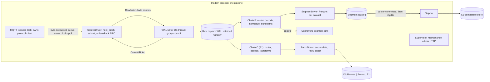

<p align="center">
  <picture>
    <source media="(prefers-color-scheme: dark)" srcset="thadam-assets/brand/thadam-logo-dark.svg">
    <source media="(prefers-color-scheme: light)" srcset="thadam-assets/brand/thadam-logo-light.svg">
    
  </picture>
</p>

<h3 align="center">The open data plane for robotics.</h3>

<p align="center">
  <a href="LICENSE"></a>
  
</p>

**Thadam is the open data plane for robotics.** It connects robotic and industrial data sources to modern data platforms with edge-native processing, durable buffering, and flexible sinks: a single Rust binary that captures telemetry at the edge, stores it durably on local disk before acknowledging it, then normalizes it into analytical datasets and delivers them to object storage and analytical databases.

Thadam is open-source, Rust-first, and edge-native. It is designed to keep capturing data through network outages and downstream downtime, and to replay what it captured when the world comes back.

> **Name status:** "Thadam" is the selected project identity, not a claim of trademark or domain availability. Registry, domain, and trademark clearance is still pending (tracked as reserved ADR-0016), so every crate is `publish = false` and nothing is published to crates.io yet.

## Project status: pre-alpha

Thadam is under active development. The architecture and the delivery guarantees are set by accepted ADRs; the code is landing milestone by milestone in public.

**Implemented today:**

- Configuration format `version: 1` with `thadam validate`, `thadam schema`, and `thadam version`, including `${env:}`/`${file:}` secret interpolation and a memory estimate.
- The capture-first write-ahead log (`thadam-wal`): segments, group-commit fsync, cursors, retention, disk budgets, crash recovery. The on-disk format is versioned but **not frozen** ([ADR-0004](docs/design/adr/0004-durable-buffer.md) awaits a hardware re-run).
- The transform chain (`thadam-transform`): router, JSON decode, identity, event IDs, deduplication, `explode`, units, time extraction, and the config-level steps `validate`, `on_change`, and `filter`.
- The MQTT source (`thadam-mqtt`, [ADR-0006](docs/design/adr/0006-mqtt-client.md)): persistent sessions, acknowledge-after-commit, ordered acks, TLS and mTLS, session-loss detection.
- The runtime (`thadam-runtime`) with supervisor, shutdown and crash recovery, the admin HTTP API (`/healthz`, `/readyz`, `/metrics`, `/status`), and Prometheus metrics; `thadam run` and `thadam status` exist at the CLI level.
- The Parquet segment sink (`thadam-segments`) and the object-store shipper (`thadam-object-store`) — locally durable segments, then oldest-first deterministic-key uploads with startup capability probing and unbounded retry.
- The seeded demo simulator (`tools/thadam-simulator`) and the `edge-capture` demo stack: a 6-robot MQTT fleet with a per-sample truth oracle, Docker Compose topology (Mosquitto, Toxiproxy, SeaweedFS, Prometheus/Grafana), and a DuckDB exploration script.

**In progress:**

- Replay (`thadam replay`), the chaos suites, the oracle verifier, and published benchmarks (PR17–PR18). Local Parquet segments (`crates/thadam-segments`) and S3-compatible delivery ([ADR-0013](docs/design/adr/0013-parquet-segment-layout.md)) are wired and run end to end; the seeded demo fleet with its truth oracle lives in [`examples/edge-capture`](examples/edge-capture).
- ClickHouse is a P1 sink that starts only after the M1 reliability gate ([ADR-0008](docs/design/adr/0008-clickhouse-sink.md), Draft).
- ROS 2 is milestone M2 and is not part of v0.1 ([ADR-0007](docs/design/adr/0007-ros2-strategy.md), Draft).

Current per-component status is tracked in [docs/design/readiness.md](docs/design/readiness.md) and [ARCHITECTURE.md](ARCHITECTURE.md) section 21.

## What Thadam does

- **Capture first.** Every accepted message is written to a local durable WAL and fsynced *before* the source is acknowledged. A crash, a misconfigured filter, or a dead sink loses nothing that was acknowledged; replay is a cursor rewind.
- **One pipeline, one binary.** A single-process, single-binary Rust runtime runs on industrial PCs, ARM edge computers, factory servers, or a laptop. Target envelope: 1–4 cores, 256 MB–2 GB RAM.
- **Robotics-aware model.** Typed events carry source and ingest time (never one overwriting the other), a time domain, event-level quality (`good`/`uncertain`/`bad` plus flags such as `OUT_OF_RANGE` and `CLOCK_SKEW`), and hierarchical identity (`site` → `robot` → `sensor`) as columns.
- **Per-sink chains.** Each sink reads the WAL independently through its own decode → transform → deliver chain, so a slow or broken sink never blocks capture or its siblings.
- **Honest delivery claims.** Guarantees are stated per hop against a claims register ([ADR-0011](docs/design/adr/0011-delivery-guarantees-and-claims-register.md)); nothing is claimed without evidence. See [Delivery guarantees](#delivery-guarantees).
- **Observable by default.** Structured JSON logs, a Prometheus/OpenMetrics endpoint, and a JSON status endpoint, with labels bounded to source, sink, and dataset ids.

## Architecture

Thadam is capture-first: a raw WAL in front, then independent per-sink chains behind it.



The full architecture is documented in [ARCHITECTURE.md](ARCHITECTURE.md); design decisions live as ADRs in [docs/design/adr/](docs/design/adr/).

## Quick start

The only dependency beyond a Rust toolchain is a container runtime for the message broker. Linux x86_64 and ARM64 are the durability targets; macOS is for development only (no durability claims).

**1. Build Thadam.** The toolchain is pinned by `rust-toolchain.toml` and installs automatically:

```bash
git clone https://github.com/Dineshkarthik/thadam.git
cd thadam
cargo build --release -p thadam-cli
./target/release/thadam version
```

**2. Start a local broker.** Mosquitto with persistence enabled (see [ADR-0006](docs/design/adr/0006-mqtt-client.md) for why the settings matter):

```bash
printf 'listener 1883\nallow_anonymous true\npersistence true\npersistence_location /mosquitto/data/\nmax_inflight_messages 100\nmax_queued_messages 200000\n' > mosquitto.conf
docker run -d --name thadam-mosquitto -p 1883:1883 \
  -v "$PWD/mosquitto.conf:/mosquitto/config/mosquitto.conf" \
  eclipse-mosquitto:2
```

**3. Write a minimal pipeline** as `pipeline.yaml`:

```yaml
version: 1
pipeline:
  name: first-pipeline
  node_id: node-01
  data_dir: ./demo-data

sources:
  - id: broker
    kind: mqtt
    config:
      url: mqtt://localhost:1883
      client_id: thadam-demo-01          # stable: names the persistent session
      topics: [{ filter: "robots/+/telemetry", qos: 1 }]
      ack_mode: on_commit               # ack after the WAL commit

wal:
  max_disk: 2GiB
  fsync: { interval: 10ms }
  on_full: block                        # explicit by design; drop_oldest is the alternative

datasets:
  - id: telemetry
    match: { source: broker, topic: "robots/+/telemetry" }
    decode: json
    identity: { robot: { id: 100, template: "{topic.1}" } }
    time: { field: /ts_us, unit: us, domain: utc, max_skew: 5s }
    fields:
      - { id: 1000, name: seq,     type: u64, from: /seq, required: true }
      - { id: 1001, name: temp_c,  type: f32, from: /temp_c }

sinks:
  - id: local
    kind: parquet
    config:
      datasets: [telemetry]
```

**4. Validate it.** This checks every key, resolves `${env:}`/`${file:}` secrets, and prints the estimated Thadam-owned memory:

```bash
thadam validate pipeline.yaml
```

**5. Run it, then inspect it.**

```bash
thadam run pipeline.yaml
thadam status                                  # JSON from the admin API
curl -s http://127.0.0.1:9464/metrics         # OpenMetrics for Prometheus
```

> **Status (see [project status](#project-status-pre-alpha)):** the pipeline above runs end to end today — messages land in Parquet segments under the data directory. The S3 shipper is likewise wired; chaos verification, replay, and published benchmark numbers are PR17–PR18 ([ARCHITECTURE.md](ARCHITECTURE.md) section 21), so nothing here is claimed faster or more durable than the [claims register](docs/design/adr/0011-delivery-guarantees-and-claims-register.md) says.

**6. Skip to the seeded demo?** [`examples/edge-capture`](examples/edge-capture) runs a synthetic six-robot fleet with a truth oracle (so delivered rows can be checked sample-by-sample), the same Mosquitto-with-raised-limits broker behind Toxiproxy, an optional SeaweedFS S3 level, a provisioned Grafana dashboard, and a DuckDB script:

```bash
cd examples/edge-capture
make up          # broker + toxiproxy + simulator (builds the simulator image once)
make run-native  # native thadam on thadam/pipeline.local.yaml (local Parquet)
make query       # DuckDB over data/sinks/local/ready/**/...
make down        # (make clean also wipes ./data and the volumes)
```

The full walkthrough, including publishing test messages and checking a config without secrets (`--allow-unresolved`), is in the book's [getting-started pages](docs/src/getting-started/first-pipeline.md). A larger example with six datasets, transforms, and an S3 target lives in [examples/edge-capture/thadam/pipeline.yaml](examples/edge-capture/thadam/pipeline.yaml) — the demo's README walks both levels (local Parquet, then S3).

For ROS 2 recordings, [`examples/ros2-mcap-to-parquet`](examples/ros2-mcap-to-parquet) replays a generated MCAP file of `sensor_msgs/JointState` and `geometry_msgs/PoseStamped` messages, decodes and validates them into local Parquet, and exports the recording back to MCAP. It needs no Docker.

## Delivery guarantees

Thadam's claims discipline is [ADR-0011](docs/design/adr/0011-delivery-guarantees-and-claims-register.md): no README, benchmark post, release note, or demo may state a guarantee that is not in the claims register, and each row needs its evidence attached before it is published. The summary:

- **MQTT → WAL:** at-least-once for QoS 1 and 2 with a persistent session and acknowledgement after WAL commit, in receive order. QoS 0 is at-most-once. Messages the broker accepts while Thadam is down survive only within the broker's queue limits and session expiry.
- **WAL durability:** with `fsync` other than `never`, acknowledged data survives a process crash. Power-loss survival is claimed only on flush-honoring industrial SSD or eMMC on Linux, and power-loss evidence from a hardware rig is still pending, so no power-loss claim is published yet. `fsync: never` survives a process crash only.
- **Ordering:** WAL order equals receive order per connection. No event-time order, no global order.
- **Replay:** row-set equivalence for a fixed WAL range, configuration hash, and enrichment hash — not byte identity.
- **Deduplication:** best-effort in Thadam (bounded warm-started window, needs a content-derived `event_id.key`); authoritative deduplication belongs downstream (`ReplacingMergeTree`, `QUALIFY`, `DISTINCT ON`).
- **Disk full:** `on_full` is a required explicit choice — `block` (withholds acks; moves loss into the broker, where it can be invisible) or `drop_oldest` (evicts WAL segments; loss is counted and surfaced as gaps). This is the single place inside Thadam where acknowledged data can be lost.
- **Not claimed:** universal exactly-once, zero-loss, or deterministic end-to-end latency (they depend on protocol, broker, storage, network, and sink).
- **Throughput:** with `ack_mode: on_commit`, one connection is bounded by roughly the broker's inflight window divided by commit latency — about 1,700 msg/s at a 10 ms commit with Mosquitto's default window of 20 (measured and modeled in spike [S2](docs/design/spikes/S2-mqtt.md)). Mitigations: producer-side batching, raised broker limits, MQTT 5 Receive Maximum, or opt-in `ack_mode: on_receive` (at-most-once across a crash).

The exact allowed wording per claim, with its conditions and evidence, is the register table in [ADR-0011](docs/design/adr/0011-delivery-guarantees-and-claims-register.md#claims-register).

## Roadmap

Milestones (owner decisions of 2026-10-07; detail in [ARCHITECTURE.md](ARCHITECTURE.md) section 1 and [product.md](product.md) section 32):

- **M1 (MVP v0.1):** MQTT source, capture WAL, local Parquet segments, S3-compatible shipping, replay, chaos verification. In progress.
- **M2:** ROS 2 — MCAP/rosbag2 offline ingestion first, live transport chosen by a spike.
- **M3 (P1):** ClickHouse sink, after the M1 reliability gate.
- **After the MVP:** HTTP and gRPC sources, windowing and aggregation, OPC UA, CAN, Modbus, Iceberg/Delta, fleet management, Python SDK, plugin mechanism.

The product.md phases map onto these: Phase 0 foundations and Phase 1 MVP runtime feed M1; Phase 2 robotics is M2; Phase 3 industrial, Phase 4 lakehouse, Phase 5 fleet/platform, and Phase 6 advanced processing follow.

## Documentation

- [ARCHITECTURE.md](ARCHITECTURE.md) — the current-state architecture of the MVP.
- [product.md](product.md) — product scope, use cases, roadmap (source of truth for product direction).
- [docs/design/adr/](docs/design/adr/) — architecture decision records, including the delivery guarantees and claims register.
- [docs/design/spikes/](docs/design/spikes/) — spike reports (S1 WAL, S2 MQTT, D8 record representation, config YAML, filter language).
- [The Thadam book](docs/src/SUMMARY.md) — the full user documentation (concepts, configuration, operations, CLI). Build it locally with `mdbook build docs` (install mdBook first) and open `docs/book/index.html`.
- [docs/design/readiness.md](docs/design/readiness.md) — implementation status per PR.

## Contributing

Contributions are welcome — see [CONTRIBUTING.md](CONTRIBUTING.md) for the toolchain, workspace layout, required checks, and the ADR process. Architecture decisions are recorded as ADRs; only the project owner accepts an ADR.

## Security

Security reports are handled privately; dependency and toolchain policy follows [ADR-0020](docs/design/adr/0020-dependency-security-and-toolchain-policy.md). See [SECURITY.md](SECURITY.md).

## License

Thadam is licensed under the [Apache License, Version 2.0](LICENSE).
