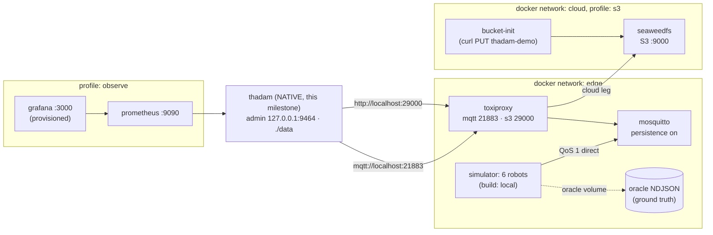

# Demo: edge-capture

**A synthetic robot fleet keeps producing data; Thadam captures it over MQTT, normalizes it, filters it, and writes durable local Parquet — optionally shipping it to S3-compatible storage.** A seeded simulator records the truth (every sample it sent, per message acks, and what the pipeline should do with it) so anything Thadam writes can be checked against that record.

This milestone ships demo levels 1 and 2, the oracle verifier (`make verify`), and chaos scenarios F1, F3, F4, F5, F7, and F8 (`make chaos-*`, see [Chaos](#chaos)). Benchmarks and `make report` are [PR18](../../ARCHITECTURE.md); replay (level 4) is PR17.

- **Level 1 — first Parquet in 10 minutes:** Mosquitto + simulator + Thadam → local Parquet → DuckDB.
- **Level 2 — edge to bucket:** + SeaweedFS S3 behind Toxiproxy, with the idempotent shipper.

## Topology



Key property of this layout: the simulator talks **directly** to the broker, so the Toxiproxy toggles used by the chaos scenarios can only affect Thadam's consumption — production and the oracle record stay clean. Thadam reaches broker and S3 **only** through Toxiproxy, so the same chaos works for in-container runs once the `thadam` image lands (PR18 builds `thadam:failpoints`; Thadam runs natively until then).

## Prerequisites

- Docker with the Compose plugin.
- The workspace's pinned Rust toolchain (for the native `thadam` build; `rust-toolchain.toml` handles it).
- Optional: `duckdb` CLI (`brew install duckdb`); `make query` falls back to a digest-pinned `duckdb/duckdb` container.
- All images are public Docker Hub / GHCR, pinned by tag (Eclipse Mosquitto, Shopify Toxiproxy, SeaweedFS, curlimages, Prometheus, Grafana — the exact pins live in [`compose.yaml`](compose.yaml)). MinIO is deliberately **not** used: its community image stopped being published to Docker Hub; SeaweedFS is the drop-in S3-compatible replacement (the `thadam-object-store` crate's docker tests pin the same image).
- **Behind a TLS-intercepting proxy?** This step is optional and only matters if the simulator image build fails certificate verification while fetching crates. Run `make secrets/ca.pem` (copies the host bundle at `/etc/ssl/cert.pem`), or place your proxy's CA chain at `secrets/ca.pem` yourself. The Dockerfile appends it to the build stage's trust store only: it is never copied into the final image, and `secrets/` is gitignored (except its `.gitkeep` placeholder). Without the file, nothing changes.

## Level 1: first Parquet in 10 minutes

**1. Start the support cast** (broker, Toxiproxy, simulator; the simulator image builds on first `up` — that build is the slow step, once):

```bash
cd examples/edge-capture
make up
make logs S=simulator     # watch the fleet publish (~245 msg/s over 6 robots)
```

Wait for mqtt traffic in the logs; the simulator publishes directly to the broker.

**2. Run Thadam natively** on the level-1 config (local data dir `./data`, admin API on 127.0.0.1:9464):

```bash
make run-native
# = cargo run -p thadam-cli -- run ./thadam/pipeline.local.yaml --admin-bind 127.0.0.1:9464 --log-format pretty
```

**3. Look at it** from another terminal:

```bash
make status            # readyz + /status JSON
make query             # DuckDB over data/sinks/local/ready/**/…
```

You should see one file-family per dataset and thousands of rows per minute: telemetry at 10 msg/s/robot and joints/imu/pose each at 10 msg/s/robot (batched samples), state on change, events filtered.

**4. Check the truth.** The simulator's oracle is the record of every sample it sent:

```bash
make oracle-stats      # totals: deliver, filtered_debug, malformed, duplicate_of, state_repeat
```

`deliver` counts (per stream) are what the pipeline writes; `sql/explore.sql` shows the same counts from the Parquet side. The chaos knobs in [`simulator/fleet.yaml`](simulator/fleet.yaml) are already active: ~0.1% malformed (quarantined), ~0.5% duplicates (deduped), robot-04's clock runs +90 s fast (flagged `CLOCK_SKEW`), robot-05 drops timestamps (null `_event_time`, flagged), robot-03 reorders pose (flagged), motor temps occasionally spike (validate-flagged, delivered).

**5. Stop.** Ctrl-C the native `thadam` (it drains the source queue, finalizes open Parquet files, commits cursors, exits 0 — `finalize_on_shutdown: true` is why files appear promptly on a 60 s rotation), then:

```bash
make down              # or: make clean  (also wipes ./data and the named volumes)
```

## Level 2: edge to bucket

```bash
make up-s3                                  # adds SeaweedFS + bucket init
make run-native CONFIG=thadam/pipeline.s3.local.yaml
```

`make` exports `THADAM_DEMO_S3_AK`/`THADAM_DEMO_S3_SK` from `secrets/` (created by `up-s3`; gitignored). Segments finalize locally, then the shipper uploads them oldest-first through the S3 Toxiproxy port with deterministic keys

```
s3://thadam-demo/fleet/thadam/v1/edge-capture/{dataset}/date=YYYY-MM-DD/hour=HH/edge-01_{epoch}_{first}_{last}.parquet
```

Inspect the bucket without extra tooling:

```bash
docker compose -f compose.yaml exec seaweedfs ls /data 2>/dev/null | head
# or any S3 CLI pointed at http://localhost:29000 (unsigned works in this demo store)
```

Point DuckDB at it (`INSTALL httpfs; LOAD httpfs;` then `s3://thadam-demo/fleet/thadam/v1/edge-capture/...`); `sql/explore.sql` notes where the same queries run over S3 globs.

**SeaweedFS caveat, by design:** its S3 gateway ignores `If-None-Match`, so the shipper's startup probe reports `conditional_create = false` and `conditional_put: auto` falls back to overwrite puts (verified against `chrislusf/seaweedfs:3.81` in the crate's docker tests). That is safe here only because segment files are immutable and keys are deterministic (node id, WAL epoch, WAL range); a store-without-probe collision instead raises a fatal `sink.object_key_collision`.

## Observability (profile `observe`)

```bash
make up-observe
```

- Prometheus: http://127.0.0.1:9090 (scrapes the native admin `/metrics` via `host.docker.internal`).
- Grafana: http://127.0.0.1:3000 (anonymous admin — demo only), the provisioned **Thadam edge-capture** dashboard from [`grafana/dashboards/edge-capture.json`](grafana/dashboards/edge-capture.json).

Dashboard rows track intake vs written, WAL commit p50/p99 and disk vs budget, segment states and sink lag, ship throughput and retries, quality flags and dedup drops, and process resources. (Ship metrics land with the shipper-metrics work item; panels show "No data" until then.)

## Chaos

Each scenario is a bash script in [`scripts/chaos/`](scripts/chaos). It runs Thadam natively against the stack, injects one fault, drains, stops Thadam cleanly, and ends by running `thadam-simulator verify` on the run's oracle and output. The script exits with verify's status (F7 has the one exception below).

```bash
make chaos                 # list scenarios
make chaos-f1 ARGS=60      # one scenario; ARGS is passed to the script
make verify                # re-verify the newest run under data/chaos/
make verify RUN=data/chaos/<run>
```

Every run writes to `data/chaos/<scenario>-<timestamp>/` (own config, oracle, logs, and output). Scripts print a timestamped timeline, so each run can be read after the fact. Requirements: Docker, `jq`, `curl`, the workspace Rust toolchain. `shellcheck` is not required.

| Scenario | Fault | Proves | Default | Expected |
|---|---|---|---|---|
| `f1-s3-partition` | Toxiproxy `s3` proxy disabled for N s, then re-enabled | An S3 network partition costs no local data; the backlog drains after heal | 30 s | verify PASS |
| `f3-s3-down` | `docker compose --profile s3 stop/start seaweedfs` for N s | Same as F1 with a dead store behind a live proxy; the store comes back with its data | 30 s | verify PASS |
| `f4-mqtt-partition` | Toxiproxy `mqtt` proxy disabled for N s (simulator still publishes to the broker) | A consumer partition loses no acknowledged data; the persistent session resumes and drains the queued messages | 30 s | verify PASS |
| `f5-crash-loop` | `kill -9` of `thadam run` K times, random 5–20 s gaps, wait for `/readyz`, restart | Crash-recovery of the WAL and the sinks loses nothing acknowledged across K hard kills | K=3 | verify PASS |
| `f7-disk-pressure` | Small budgets (`pipeline.disk-pressure.yaml`: 8 MiB WAL, 1 MiB segments, 16 MiB sink, `on_full: drop_oldest`), S3 not used | WAL disk stays within budget plus one segment; losses are attributed to `on_full` evictions | 60 s | see below |
| `f8-poison` | Simulator burst at a high malformed rate (default 0.25 for 20 s) | Every injected malformed sample lands in quarantine, none in the datasets | 30 s, 0.25 | verify PASS |

Arguments: `f1`, `f3`, `f4`: `[SECONDS]`. `f5`: `[KILLS]` (env `F5_SEED` fixes the gap sequence). `f7`: `[SECONDS]`. `f8`: `[BURST_SECONDS] [MALFORMED_RATE]`.

**Drain and the source of truth.** A scenario waits until the source is idle (every received batch is in the WAL, and the WAL has stopped growing for 5 s) and then stops Thadam with SIGTERM, which finalizes the open Parquet files. Verify runs only after that, and it is the authoritative check. Sink cursor lag is not awaited, because an idle live sink does not advance its watermark until rotation or shutdown. In live runs the reported lag at the drain point was roughly 1,600 to 2,900 frames; the finalize step clears it.

**F5 gaps differ from the e2e test.** The script uses random 5–20 s gaps. The ignored Rust test below uses fixed 3 s gaps so it runs in about 40 s.

**F7 exit rule.** F7 exits 1 if the WAL peak exceeds budget plus one segment, or if no evictions happened (the budget never engaged). Otherwise it exits 0: when verify passes, or when verify fails but the failures are attributed to `on_full: drop_oldest` evictions (`wal.evicted_bytes` > 0). In the live run, evictions happened (about 23 MB) and verify passed, so no rows were lost and the attributed-loss path did not trigger.

**Known gap, S3 (F1, F3).** These scenarios run `pipeline.s3.local.yaml`. Verify checks the local output, which is complete. In the live runs the bucket stayed empty after finalize, and the log showed no upload activity. The S3 shipping path is therefore not demonstrated by these scripts yet. The bucket count is printed for information only.

**Ignored Docker test.** The end-to-end test `crash_loop_delivery_matches_the_oracle` (`tools/thadam-simulator/tests/e2e_edge_capture.rs`) runs the F5 shape in-process. Run it with:

```bash
cargo nextest run -p thadam-simulator --run-ignored only
```

It needs Docker, so it is `#[ignore]`d by default. It runs three SIGKILLs and asserts verify passes, then removes its containers and volumes.

## How the oracle maps to the data

The simulator writes `oracle/oracle.ndjson` — one JSON object per **sample** (exploded streams count each sample):

```json
{"site":"site-a","robot":"robot-01","stream":"telemetry","seq":41,"sample_idx":0,
 "ts_us":1791369600123456,"publish_acked":true,"expected":"deliver","flags":["out_of_range"]}
```

| `expected` | Pipeline behavior |
|---|---|
| `deliver` | row lands in the dataset (possibly with quality flags) |
| `filtered_debug` | `filter` transform drops it (`level: debug` event) |
| `malformed` | truncated JSON → decode reject → `_quarantine` dataset |
| `duplicate_of` | same `seq` re-publish → message-level dedup drop |
| `state_repeat` | `on_change` drop: identical `(mode, cycle_id, program)` inside the heartbeat window |

Dedup is configured on **all six** datasets in the demo configs (`state` and `events` carry a 50k window; the high-rate streams 500k): the simulator's duplicate chaos applies to every stream, so dedup must see all of them for the `duplicate_of` expectation to be testable. `pipeline.yaml` (the container topology reference) was adjusted to match — the only PR15 config change, keeping `thadam validate` clean.

## The simulator

Source: [`tools/thadam-simulator`](../../tools/thadam-simulator) (they must be bitwise-identical payloads for a given seed — see the crate's determinism tests).

```text
thadam-simulator run
    --fleet <path>          fleet.yaml (built-in defaults when absent)
    --broker mqtt://h[:p]   plaintext only (no TLS in this build)
    --oracle <path>         created O_EXCL; append-only NDJSON
    --seed N --scale N      overrides; --scale multiplies robots per site
    --duration 30s          stop generating after a wall-clock cap
    --drain-timeout 8s      ack-wait budget at shutdown
    --malformed-rate P --duplicate-rate P --out-of-range-rate P
    --unbatched             one sample per message (ack-window benchmark)
    --log-format pretty|json

thadam-simulator oracle-stats <oracle.ndjson> [--json]
```

Streams per robot: telemetry 10 Hz (1 sample), joints 100 Hz (10/msg), imu 200 Hz (20/msg), pose 50 Hz (5/msg, `frame: map`), state on change + 60 s heartbeat, events ~0.5/s Poisson including `cycle_start`/`cycle_end` pairs, faults, alarms, and 40% debug noise. Topics: `thadam-demo/v1/{site}/{robot}/{stream}`, QoS 1, no retained messages (retained messages would replay on every resubscribe and look like duplicates — the docs explain why the demo avoids them).

## What this milestone does NOT include

- **Chaos scenarios F2, F6, F9, F10, benchmarks, and `make report`** — PR18. F2, F6, F9, and F10 have no scripts here yet.
- **Replay (level 4)** — PR17; the catch is the WAL `retain_for: 1h` and `replay --output` never writing to production paths.
- **A `thadam` container image.** Thadam runs natively here (`make run-native`); the published image (and thus the true cold-clone-under-10-minutes gate) lands with PR18's `thadam:failpoints` image work. Level-1 end-to-end on a warm checkout is a couple of minutes; the first `make up` also builds the simulator image.
- **Power-loss honesty.** Containers cannot simulate it; the `fsync: { interval: 50ms }` exposure window is what it is, and hardware-rig evidence is pending before any power-loss claim (see the repo README's claims discipline). macOS is for development only; durability statements cover Linux.
- **Security hardening.** Anonymous MQTT, HTTP-only S3, unsigned bucket operations, and a token-less loopback admin bind are demo-only postures. A TLS/mTLS broker variant and the least-privilege bucket policy (no `DeleteObject`, no `ListBucket`) are documented follow-ups.

## Files

```text
compose.yaml                       topology + observe/s3 profiles
Makefile                           the demo entry point (make help)
mosquitto/mosquitto.conf           persistence + raised queue limits (and why)
toxiproxy/toxiproxy.json           mqtt 21883 and s3 29000 proxies
simulator/fleet.yaml               fleet, rates, behavior model, chaos knobs
thadam/pipeline.yaml                container-topology reference (level 2 shape)
thadam/pipeline.local.yaml          LEVEL 1 (native): local Parquet only
thadam/pipeline.s3.local.yaml       LEVEL 2 (native): + S3 through the proxy
thadam/pipeline.disk-pressure.yaml  CHAOS F7: small WAL/segment/sink budgets, no S3
scripts/chaos/                     chaos scenarios (F1, F3, F4, F5, F7, F8) and lib.sh
seaweedfs/create-bucket.sh         idempotent bucket init (unsigned, demo store)
prometheus/prometheus.yml          scrapes the native admin /metrics
grafana/                           provisioned datasource + dashboard
sql/explore.sql                    DuckDB tour of the local segments
secrets/                           generated by make up-s3, gitignored
data/                              thadam data dir, gitignored
```
